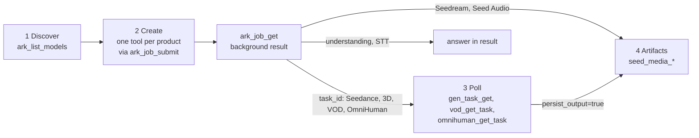

# Ark Seed Multimodal MCP Server

Typed MCP tools for BytePlus multimodal generation, over `stdio` or Streamable
HTTP. The server already publishes every tool's description and schema, so this
skill covers only what the schemas cannot tell you: the flow, the rules that
span tools, and where to look things up. **Parameters live in the tool
schemas** (full reference: [docs/api-reference.md](../../../docs/api-reference.md)).

| Product | Create tool | Poll / result | Enabled by |
|---|---|---|---|
| **Seedance** video (2.0, 2.5, 2.5 Premium) | `seedance_create_task` | `gen_task_get`, `gen_task_list`, `gen_task_cancel_or_delete` | `BYTEPLUS_MODELARK_API_KEY` (Premium model also needs `BYTEPLUS_MODELARK_SEEDANCE_2_5_PREMIUM_ENABLED=true`) |
| **Seedream** images (generate and edit) | `seedream_generate_image` | artifacts in the result | `BYTEPLUS_MODELARK_API_KEY` |
| **Seed Audio** | `seed_audio_generate` | artifact in the result | `BYTEPLUS_SEED_SPEECH_API_KEY` |
| **Seed 3D** (Hyper3D, Hitem3d) | `hyper3d_create_task`, `hitem3d_create_task` | `gen_task_get`, `gen_task_list`, `gen_task_cancel_or_delete` | `BYTEPLUS_MODELARK_3D_ENABLED=true` + ModelArk key |
| **OmniHuman 2.0** avatar video | `omnihuman_create_task` | `omnihuman_get_task`, `omnihuman_cancel_task` | `BYTEPLUS_OMNIHUMAN_ENABLED=true` + `BYTEPLUS_CV_API_KEY` |
| **VOD MediaKit** | `vod_enhance_video`, `vod_transcode_video`, `vod_add_subtitles`, `vod_remove_subtitles`, `vod_separate_audio` | `vod_get_task` | `BYTEPLUS_VOD_MEDIAKIT_API_KEY` |
| **Understanding** | `seed_understand`, `seed_audio_understand` | answer in the result | `BYTEPLUS_MODELARK_API_KEY` |
| **Speech-to-text** | `speech_to_text` | transcript in the result | `BYTEPLUS_SEED_SPEECH_API_KEY` |
| **Object storage** | `media_upload`, `media_presign` | URLs in the result | TOS or S3 credentials |
| **Asset library** (`asset://`) | eight `ark_asset_*` tools | — | `BYTEPLUS_MODELARK_ACCESS_KEY` + `_SECRET_KEY` |
| **Always registered** | `ark_list_models`, `ark_job_*`, `seed_media_*` | — | — |

**Do not assume a tool exists.** A tool registers only when its gate passes;
`ark_list_models.services` and the `seed-health://status` resource show what is
on and which setting enables the rest.

## How to use this server



1. **Discover.** `ark_list_models` returns the configured models, their
   limits, which tool takes each, and `services`. **`model` accepts exact IDs
   only**; an unknown ID fails with a did-you-mean hint. Omit `model` for the
   default. Optional account pricing comes from a cached snapshot; discovery
   never calls the provider. Check `pricing_status` before relying on it.
2. **Create.** One tool per product, run through `ark_job_submit` (see
   [Background jobs](#background-jobs)). Use `variations` instead of looking
   for variation tools, and `dry_run` (Seedance, Seedream) to check a request
   and its cost without billing.
3. **Poll.** Seedance and 3D with `gen_task_get`; VOD with `vod_get_task`
   **and the `operation` the create tool echoed**; OmniHuman with
   `omnihuman_get_task`. **Never resubmit a create tool to poll**; that bills
   a second task.
4. **Keep artifacts.** `seed_media_get_artifact`, `seed_media_export_artifact`,
   `seed_media_persist_url`, and `seed-media://` resources.

## Rules the schemas do not tell you

### Background jobs

- **Required background** (a foreground call is rejected before any provider
  call): every create tool above, `seed_understand`, `seed_audio_understand`,
  `speech_to_text`, and `media_upload`.
- **Optional** (foreground works; background only to persist output or wait
  long): `gen_task_get`, `vod_get_task`, `omnihuman_get_task`,
  `seed_media_persist_url`, `ark_asset_create`, `ark_asset_verification_result`.
  Everything else is foreground.
- **Submit** with `ark_job_submit` and `{"input": {"tool_name": "<tool>",
  "arguments": {"input": {...tool input...}}}}`, then poll `ark_job_get` no
  faster than `poll_after_ms` and read the tool result from `result`
  (`structured_content`). A client that negotiates native MCP task
  augmentation may call the tool directly with task metadata instead.
- **The Ark `job_id` is not a provider task ID.** The provider ID is inside
  the job result. Submission is non-idempotent: after a timeout or lost
  response, do not blindly resubmit (reconcile first). Stdio jobs are
  process-local.
- Inside `ark_job_submit` there are no MCP roots, so local writes
  (`output_path`, `output_dir`, `save_to`) need `OUTPUT_ROOTS` set on the
  server; otherwise they are rejected before any provider call.
  `persist_output=true` works. See
  [background-job-output.md](references/background-job-output.md).

### Models, variations, dry runs

- Per-model limits (resolutions, durations, reference counts, Draft support,
  formats) are checked at runtime. **All violations come back in one error**
  that points to `ark_list_models`; fix them all, or use `dry_run`.
- `SEEDANCE_DEFAULT_MODEL` is Seedance 2.5. **Premium is a model ID**, present
  only when its flag is on; there are no Premium tools.
- `variations`: Seedance 1-5 (separate billed tasks, `tasks[]`), Seedream 1-10
  (`summary`), Seed Audio 1-5 (`summary`). Failures are per variation. Seedream
  `seed` is the base seed (`N, N+1, ...`); `max_images` and `variations > 1`
  are mutually exclusive.
- `dry_run` returns `preview` (request bodies, cost estimate) and bills nothing.

### Seedance

- **Draft (2.5 models only):** `draft=true` makes a cheap 480p preview; once it
  has `succeeded` (at most 7 days old), call again with only `draft_task_id`
  (plus `return_last_frame`, `watermark`, `output_format` and similar) to render
  the final video. The Draft's model, prompt, media, duration and ratio are
  reused and must be omitted; `variations` must be 1.
- Video references must be public HTTPS URLs (or `asset://`); use
  `media_upload` for local files.
- Refer to `asset://` references in prompts as "Image 1", "Video 1" by position.

### Seedream

- `images` plus optional `point` or `bbox` (0-999, on the first image) edits;
  without images it is text-to-image.
- `background="transparent"` needs Seedream 5.0 Pro, **exactly one PNG input
  that already has transparent pixels**, and `output_format` omitted or `png`.
  It edits that image and keeps the transparency; it does not cut a subject out
  of an opaque image.

### Polling and persistence

- **Two phases.** Poll `gen_task_get` / `vod_get_task` in the foreground
  (`persist_output` defaults to `false`; pass every task ID in one
  `gen_task_get` call). When `all_terminal` is true (VOD: `status` is
  `succeeded`), run the poller **once** through `ark_job_submit` with
  `persist_output=true` to keep the outputs. `omnihuman_get_task` defaults to
  `true`; pass `false` for a foreground poll.
- `queued` / `running` / `processing` is not a failure. Wait
  `recommended_poll_after_ms` (default 5000).
- Provider URLs expire: **2 hours for audio, 24 hours for image, video, 3D and
  MediaKit output, 1 hour for OmniHuman**. An artifact with id `provider-url`
  and a `persistence_error` is still usable until then; recover it with
  `seed_media_persist_url`.
- `output_path`, `output_dir`, `save_to` write to local disk on **stdio only**,
  inside the client's MCP roots (or `OUTPUT_ROOTS`), and need persistence
  (`persist` / `persist_output`). A directory ending in `/` is required when
  several files are written (variations, `max_images > 1`, VOD
  `separate_audio`).

### Media upload and assets

- **Audio understanding:** `seed_audio_understand.delivery` defaults to `auto`,
  which retries rejected URL audio through Files API. `files_api` uploads first;
  `direct` disables fallback. Files API supports up to 512 MB and video inputs
  include sampled frames as well as the soundtrack. Cleanup is best effort;
  never blindly retry an ambiguous upload timeout.
- **`media_upload` and `media_presign` items fail independently.** Always check
  `failed` and `items[].error` (`media_presign` codes: `INVALID_KEY`,
  `NOT_OWNED`, `INTERNAL`, or a provider code). Only an over-size request
  (`MEDIA_UPLOAD_BATCH_MAX_BYTES`) fails the whole call. Use a long
  `expires_in_seconds` (e.g. 3600) for URLs that `vod_*` tools fetch later.
- An uploaded `object_key` also works as an `ark_asset_create` source.
- **Asset library:** `asset://<id>` is accepted natively by Seedance only, and
  **only `Active` assets work** (check `all_active` / `status`). Create AIGC
  groups with `ark_asset_group_ensure` by subject name (never invent group
  IDs). Real people need `ark_asset_verification_start` (the person opens the
  link and consents) and then `ark_asset_create(group_id=...)` with only
  that person's media. `ark_asset_list` / `ark_asset_group_list` read up to 20
  items by ID (`errors[]` lists unreadable IDs).
- **`ark_asset_delete`** exists only when
  `BYTEPLUS_MODELARK_ASSETS_ALLOW_DELETE=true`. It needs `confirm: true`, and
  a non-empty group is refused unless `cascade=true` (that deletes its assets;
  confirm with the user first). The `group_created_empty` cleanup hint on
  `ark_asset_create` only works when delete is enabled.

## Examples

Seedance: submit, then poll in the foreground.

```json
{"input": {"tool_name": "seedance_create_task", "arguments": {"input": {
  "prompt": "A paper boat drifts down a rainy street", "resolution": "1080p", "duration": 8}}}}
```

After `ark_job_get` returns the job result, take `tasks[0].task_id` and call
`gen_task_get` with `{"task_ids": ["<task_id>"]}`; repeat until `all_terminal`.

Seedream: edit a region of an image (submitted the same way).

```json
{"prompt": "Replace the boxed object with a red bicycle",
 "images": [{"kind": "url", "url": "https://cdn.example.com/street.png"}],
 "bbox": {"x1": 120, "y1": 400, "x2": 560, "y2": 900}}
```

Asset reference: `ark_asset_create` with `{"subject": "Teal Hero", "sources":
[{"url": "https://cdn.example.com/hero.png"}]}`; when `all_active` is true, pass
each returned `asset_uri` as `images: ["asset://asset-..."]` to
`seedance_create_task`.

## Errors

| Symptom | Cause | Fix |
|---|---|---|
| Tool missing | Its gate is off (missing key or flag) | Check `ark_list_models.services` and the enabling setting in the table above |
| Foreground call to a create tool rejected | Background is required | Submit through `ark_job_submit` |
| `Request is not valid for model ...` | The request breaks that model's limits (all listed) | Fix every item, pick another model from `ark_list_models`, or recheck with `dry_run` |
| Unknown `model` | Not an exact configured ID | Use the suggested ID or one from `ark_list_models` |
| Timeout with `ambiguous_completion=true` | Create or cancel may have succeeded | Reconcile by task or request ID; do not resubmit |
| `queued` / `running` for a long time | Normal provider queue | Keep polling `gen_task_get`; `queue.hint` explains the wait |
| `persistence_error` on an artifact | Output billed, storage failed | `seed_media_persist_url` before the URL expires |
| Variation `error.phase` | `queued` (`QUEUE_TIMEOUT`): safe to retry; `generating`: may have completed; `persisting`: output not stored | Retry only `queued` ones |
| `NOT_OWNED` | The caller did not create that task or key | Use the original principal |
| OmniHuman failed `InvalidParameter ... audio` or error `50510` | Provider rejected the audio or content after submission | Fix the inputs; never retry unchanged |
| Budget rejected | `DAILY_BUDGET_USD` exceeded | Wait for the UTC day rollover or raise it |

## References

Read these only when you need the detail:

- [tool-reference.md](references/tool-reference.md): per-product notes for Seedance, Seedream, Seed Audio, 3D, OmniHuman and VOD.
- [polling-and-artifacts.md](references/polling-and-artifacts.md): pollers, cancel/delete, artifact tools, local paths, persistence fallbacks.
- [understanding-media-assets.md](references/understanding-media-assets.md): understanding, speech-to-text, object storage, asset library.
- [models-and-limits.md](references/models-and-limits.md): per-family limits and model selection.
- [workflows.md](references/workflows.md): background jobs in depth, production workflows, retry policy, common issues.
- [environment.md](references/environment.md): credentials, flags, transport, auth, architecture.
- [background-job-output.md](references/background-job-output.md): local-write options inside `ark_job_submit`.
- [docs/api-reference.md](../../../docs/api-reference.md): every tool's parameters and outputs.
