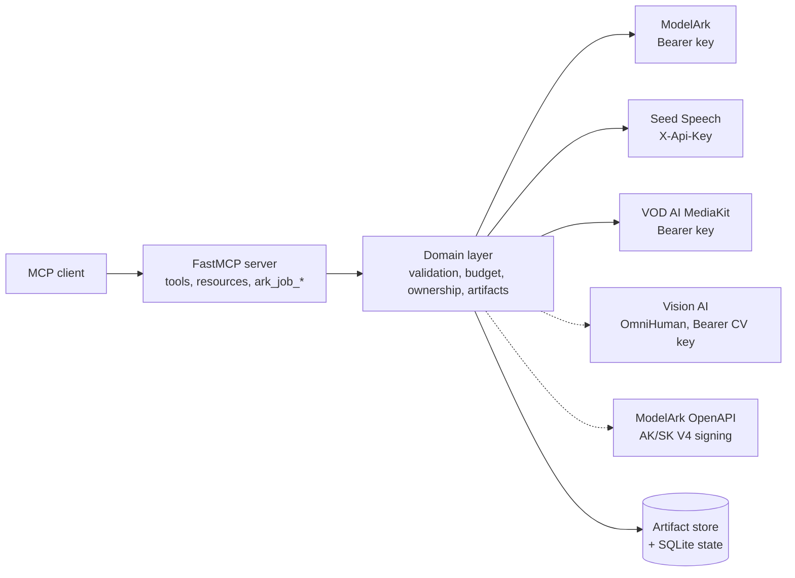

# Environment, transports, and architecture

Operator-side setup an agent occasionally needs: how the server is started,
which setting turns on which tools, how HTTP auth and scopes work, the runtime
services behind the tools, and the provider design. Model IDs and limits are
in [models-and-limits.md](models-and-limits.md). The full variable reference
is [docs/configuration.md](../../../../docs/configuration.md); security detail
is [docs/security.md](../../../../docs/security.md).

## Quick start

**Prerequisites:** Python 3.12+, `uv`, and a BytePlus key for each product you
want. Copy `.env.example` to `.env`; credentials are startup configuration and
are never tool arguments.

```bash
uv run python -m ark_mcp                       # stdio (default), local MCP clients
MCP_TRANSPORT=http uv run python -m ark_mcp    # Streamable HTTP, 127.0.0.1:3000, path /mcp
```

- **HTTP is stateless Streamable HTTP** with Host/Origin protection on
  (`MCP_ALLOWED_HOSTS`, `MCP_ALLOWED_ORIGINS`). `fastmcp run
  src/ark_mcp/server.py:mcp` also works and applies the same hardening.
- **Verify** with the `seed-health://status` resource or, on HTTP, `GET /health`,
  `/ready`, `/metrics`.
- Output-path arguments (`output_path`, `output_dir`, `save_to`) work on stdio
  only, inside MCP roots or `OUTPUT_ROOTS` ([polling-and-artifacts.md](polling-and-artifacts.md)).

## What enables what

**Do not assume a fixed tool count.** A tool registers only when its gate
passes; the server degrades to whatever is configured. `ark_list_models.services`
and `seed-health://status` report what is on.

| Setting | Enables |
|---|---|
| (always) | `ark_list_models`, `ark_job_*`, `seed_media_get_artifact`, `seed_media_export_artifact`, `seed_media_persist_url`, `seed-health://status` |
| `BYTEPLUS_MODELARK_API_KEY` | `seedream_generate_image`, `seedance_create_task`, `gen_task_get` / `gen_task_list` / `gen_task_cancel_or_delete` (also the poll tools for 3D), `seed_understand`, `seed_audio_understand` |
| `BYTEPLUS_SEED_SPEECH_API_KEY` | `seed_audio_generate`, `speech_to_text` (one key, both products) |
| `BYTEPLUS_VOD_MEDIAKIT_API_KEY` | `vod_enhance_video`, `vod_transcode_video`, `vod_add_subtitles`, `vod_remove_subtitles`, `vod_separate_audio`, `vod_get_task` |
| `BYTEPLUS_MODELARK_3D_ENABLED=true` + ModelArk key | `hyper3d_create_task`, `hitem3d_create_task` (default off; reuses the ModelArk key) |
| `BYTEPLUS_MODELARK_SEEDANCE_2_5_PREMIUM_ENABLED=true` + ModelArk key | Binds the whitelist-only Premium (4K) model so `seedance_create_task` accepts it as `model`. **No extra tools**; default off; ID from `SEEDANCE_2_5_PREMIUM_MODEL` |
| `BYTEPLUS_OMNIHUMAN_ENABLED=true` + `BYTEPLUS_CV_API_KEY` | `omnihuman_create_task`, `omnihuman_get_task`, `omnihuman_cancel_task`. Separate Vision AI Bearer key; default off. Overrides: `BYTEPLUS_CV_BASE_URL`, `BYTEPLUS_OMNIHUMAN_REQ_KEY` |
| `BYTEPLUS_MODELARK_ACCESS_KEY` + `BYTEPLUS_MODELARK_SECRET_KEY` | `ark_asset_group_ensure`, `ark_asset_group_list`, `ark_asset_create`, `ark_asset_list`, `ark_asset_update`, `ark_asset_verification_start`, `ark_asset_verification_result` (plus `BYTEPLUS_MODELARK_SESSION_TOKEN` for STS `AKTP...` keys) |
| `BYTEPLUS_MODELARK_ASSETS_ALLOW_DELETE=true` + AK/SK | Additionally registers the irreversible `ark_asset_delete` (default off) |
| `TOS_ACCESS_KEY` + `TOS_SECRET_KEY` + `TOS_BUCKET` (default backend) | `media_upload`, `media_presign` |
| `OBJECT_STORAGE_BACKEND=s3` + `S3_ACCESS_KEY` + `S3_SECRET_KEY` + `S3_BUCKET` | Same two tools on S3 or S3-compatible storage (`S3_ENDPOINT`) |

Gotchas that follow from the gates:

- **`gen_task_*` registers whenever ModelArk is configured**, not only with the
  3D flag.
- **Seedance asset references need only the ModelArk key**: `asset://<id>` is
  accepted natively. AK/SK are needed to manage assets, and for the optional
  pre-submit check (`SEEDANCE_ASSET_PREFLIGHT`, default `true`, needs AK/SK).
- **Object storage selects one backend**; credentials for the other do not
  register the tools. `media_upload` and `media_presign` register together.
- **The `group_created_empty` cleanup hint** ("delete the empty group") only
  works when `ark_asset_delete` is registered.
- **`BYTEPLUS_MODELARK_ASSET_REFERENCE_MODE`** (`off` default, `resolve`):
  Seedream and Seed Audio reject `asset://` references; `resolve` swaps in the
  asset's temporary URL (experimental, needs AK/SK).
- **`BYTEPLUS_MODELARK_ASSET_CREATE_QPM`** (default `3`) is a client-side
  `CreateAsset` pacing limit; match your tier: 3 Entry, 120 Advanced, 300 Premium.
- A custom model ID must be bound (`SEEDREAM_MODEL_BINDINGS`,
  `SEEDANCE_MODEL_BINDINGS`, `SEED_UNDERSTANDING_MODEL_BINDINGS`,
  `SEED3D_MODEL_BINDINGS`); see [models-and-limits.md](models-and-limits.md).

### Provider hosts and timeouts

| Variable | Default | Notes |
|---|---|---|
| `BYTEPLUS_MODELARK_BASE_URL` | `https://ark.ap-southeast.bytepluses.com/api/v3` | Key is region-scoped; must match |
| `BYTEPLUS_SEED_AUDIO_BASE_URL`, `SEED_SPEECH_ASR_BASE_URL` | `https://voice.ap-southeast-1.bytepluses.com` | Seed Audio / ASR hosts |
| `BYTEPLUS_VOD_MEDIAKIT_BASE_URL` | `https://mediakit.ap-southeast-1.bytepluses.com/api/v1` | Must be HTTPS |
| `BYTEPLUS_MODELARK_OPENAPI_BASE_URL` | `https://ark.ap-southeast-1.byteplusapi.com` | Asset library control plane (signed with AK/SK) |
| `SEED_SPEECH_ASR_POLL_INTERVAL_SECONDS` / `_MAX_SECONDS` | `3` / `600` | Server-side ASR polling cadence and ceiling |
| `BYTEPLUS_CONNECT_TIMEOUT_MS` / `BYTEPLUS_REQUEST_TIMEOUT_MS` | `10000` / `600000` | Provider connect and full-request timeouts |
| `SEED_UNDERSTANDING_TIMEOUT_MS` | request timeout | `seed_understand` and `seed_audio_understand`; deep thinking can need more |

## Transport and auth

| Mode | Where | Behaviour |
|---|---|---|
| `MCP_AUTH_MODE=local` (default) | stdio or loopback HTTP | One trusted principal `local`; no scopes checked |
| `MCP_AUTH_MODE=jwt` | HTTP (required off loopback) | RS256 JWT verified against a JWKS; every call needs a principal, scopes enforced per tool |

- **Fail closed:** HTTP on a non-loopback `MCP_HOST` with `local` auth refuses to
  start. Over loopback, any local process that can reach the port acts as
  `local` (all clients of one loopback server see each other's background jobs),
  so do not proxy it.
- **JWT mode requires** `MCP_JWT_JWKS_URI` (https), `MCP_JWT_ISSUER`,
  `MCP_JWT_AUDIENCE`. Principal is `sub` (else `client_id`); tenant comes from
  the claim named by `MCP_TENANT_CLAIM` (default `tenant_id`); tokens need `exp`.
  Optional: `MCP_JWT_CLOCK_SKEW_SECONDS` (30), `MCP_JWT_PROVIDE_DISCOVERY` with
  `MCP_PUBLIC_BASE_URL` and `MCP_JWT_SCOPES_SUPPORTED` for OAuth discovery.
- **Create scopes are per product** (that is where spend happens); read and
  delete scopes are shared. `ark_list_models` and `ark_job_*` need a principal
  but no scope: job tools enforce the **target tool's** scope at submit time.
- `seed-health://status`, `/health`, `/ready`, `/metrics` are not scope-protected.

### Scopes per tool (JWT mode)

| Scope | Tools |
|---|---|
| `seedream:generate` | `seedream_generate_image` |
| `seedance:create` | `seedance_create_task` |
| `gen:read` / `gen:delete` | `gen_task_get`, `gen_task_list` / `gen_task_cancel_or_delete` (Seedance and 3D tasks) |
| `seed:audio:generate` | `seed_audio_generate` |
| `seed:asr:transcribe` | `speech_to_text` |
| `understanding:read` | `seed_understand`, `seed_audio_understand` |
| `hyper3d:create`, `hitem3d:create` | `hyper3d_create_task`, `hitem3d_create_task` |
| `omnihuman:create` / `:read` / `:cancel` | `omnihuman_create_task` / `omnihuman_get_task` / `omnihuman_cancel_task` |
| `vod:enhance`, `vod:transcode`, `vod:extract`, `vod:subtitle:add`, `vod:subtitle:remove` | The matching `vod_*` submit tool (`vod_separate_audio` is `vod:extract`) |
| `vod:read` | `vod_get_task` |
| `media:upload` | `media_upload`, `seed_media_persist_url` |
| `media:presign` | `media_presign` |
| `artifacts:read` | `seed_media_get_artifact`, `seed_media_export_artifact`, `seed-media://artifacts/{id}` |
| `assets:read` / `assets:write` | `ark_asset_group_list`, `ark_asset_list` / `ark_asset_group_ensure`, `ark_asset_create`, `ark_asset_update` |
| `assets:verify` / `assets:delete` | both `ark_asset_verification_*` tools / `ark_asset_delete` |

Asset management acts on the whole BytePlus account, not per principal: grant
`assets:*` only to trusted callers.

## HTTP rate limiting and readiness

- **Rate limit** (HTTP only): `RATE_LIMIT_RPM` (default `0` = off) per client IP
  token bucket, `RATE_LIMIT_BURST` (`0` = RPM). Over the limit returns `429` with
  `Retry-After` and `X-RateLimit-*` headers. Enable
  `RATE_LIMIT_TRUST_PROXY_HEADERS` **only** behind a proxy that overwrites
  `X-Forwarded-For`, or clients can pick their own bucket.
- **Request body cap:** `MCP_HTTP_MAX_BODY_BYTES` (default 300 MiB, sized for the
  largest Base64 video); oversize returns `413`.
- **`/health`** is liveness only. **`/ready`** returns `503` until the ownership
  store answers and the artifact directory is writable.
  `READINESS_CHECK_PROVIDERS=true` also probes each configured provider
  (`READINESS_PROVIDER_TIMEOUT_SECONDS`, default 2.0 each) and reports
  `reachable` / `unreachable` per provider.

## Persistence and runtime

| Service | Behaviour | Settings |
|---|---|---|
| Artifact store | Durable media, metadata, ownership, TTL cleanup; a billed output is never dropped because storage failed | `ARTIFACT_BACKEND` (`filesystem` default, or `object_storage`), `ARTIFACT_DIR` (`~/.ark-mcp/artifacts`), `ARTIFACT_TTL_SECONDS` (7 days), `ARTIFACT_SWEEP_INTERVAL_SECONDS` |
| Ownership / budget / cache state | SQLite, single instance; task ID to principal mapping enforced for Seedance and 3D | `STATE_BACKEND=sqlite`, `STATE_PRUNE_MAX_AGE_DAYS` (30), `PERSISTENCE_CACHE_MAX_SIZE` / `_TTL_SECONDS` |
| Budget ledger | Per-principal UTC daily spend estimate; a call that would exceed the limit is rejected before it reaches the provider | `DAILY_BUDGET_USD` (`0` records without blocking) |
| Provider limiters | Per-provider semaphore for every call; per-principal semaphore for JWT principals only (stdio and local HTTP are bounded by the provider limit alone) | `PROVIDER_MAX_CONCURRENCY` (5), `PRINCIPAL_MAX_CONCURRENCY` (3) |
| Safe downloader | SSRF-safe provider-output downloads with IP pinning and redirect validation; retries timeouts, network errors, 408/429/5xx with 1s, 2s, 4s backoff; never retries policy failures | `ARTIFACT_DOWNLOAD_TIMEOUT_SECONDS` (120), `ARTIFACT_DOWNLOAD_MAX_ATTEMPTS` (3) |
| Background jobs | FastMCP task backend behind `ark_job_*`; the default in-memory backend is process-local, so a restart discards active and retained jobs | `FASTMCP_DOCKET_URL` (`memory://`), `FASTMCP_DOCKET_CONCURRENCY` (10), `FASTMCP_TASKS_ENCRYPTION_KEY` (required for JWT with Redis) |

- **Inline fallback:** if storage fails for inline Base64 output (Seed Audio,
  Seedream `b64_json`), it is returned inline up to
  `ARTIFACT_INLINE_FALLBACK_MAX_BYTES` (default 8 MiB; `0` disables).
  `MCP_INLINE_MEDIA_MAX_BYTES` (8 MiB) caps inline image/audio content blocks.
- **`MEDIA_UPLOAD_BATCH_MAX_BYTES`** (default 500 MiB) caps the total decoded
  size of one `media_upload` call; only exceeding it fails the whole call.
  Presigned URLs live `TOS_PRESIGN_TTL_SECONDS` / `S3_PRESIGN_TTL_SECONDS`
  (60 to 604800, default 1800).
- **Single process only:** artifact, ownership, budget, cache, and limiter state
  are not shared across replicas.

### Retry policy

**Only safe failures are retried.** A provider error is retried (up to 3
attempts, 0.25s base delay doubling to a 4s cap, 20% jitter, honouring
`Retry-After`) only when it is marked `retryable` and **not**
`ambiguous_completion`. Billed create calls whose completion is ambiguous
(timeouts, 5xx after submit) are never retried automatically: check the task
or resubmit deliberately. Chat-completion understanding calls do not retry
timeouts at all, since a second full-length attempt would double latency and
cost (429 and 5xx are still retried).

## Architecture

**Three provider gateways sit behind one normalized domain layer**, each with
its own host and credential:



| Provider | Auth | Products |
|---|---|---|
| ModelArk data plane | `Authorization: Bearer <BYTEPLUS_MODELARK_API_KEY>` | Seedream, Seedance, 3D (Hyper3D, Hitem3d), Seed 2.1 and audio understanding |
| Seed Speech | `X-Api-Key: <BYTEPLUS_SEED_SPEECH_API_KEY>` | Seed Audio and Speech-to-Text (told apart by `X-Api-Resource-Id`, not by key) |
| VOD AI MediaKit | `Authorization: Bearer <BYTEPLUS_VOD_MEDIAKIT_API_KEY>` | Enhancement, transcode, subtitles, audio separation |
| Vision AI (optional) | `Authorization: Bearer <BYTEPLUS_CV_API_KEY>` | OmniHuman 2.0 |
| ModelArk OpenAPI (optional) | IAM AK/SK, V4 signatures | Private asset library |

Inputs are validated against a model-capability registry before quota is spent
([models-and-limits.md](models-and-limits.md)). For tool inputs and outputs see
the tool schemas and [docs/api-reference.md](../../../../docs/api-reference.md).
