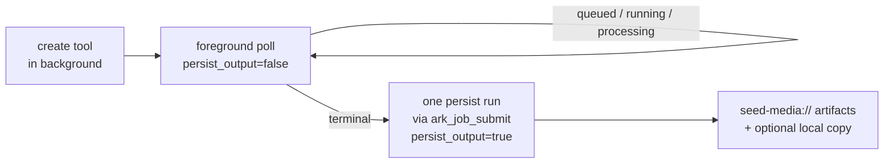

# Polling and artifacts

How to poll asynchronous provider tasks, what the persistence layer does with finished outputs, and how to recover or export them. Parameters and output fields are in the tool schemas ([docs/api-reference.md](../../../../docs/api-reference.md)); this file covers behaviour the schemas do not.

## Which poller for which task

| Task ID comes from | Poll | Clean up |
|---|---|---|
| `seedance_create_task`, `hyper3d_create_task`, `hitem3d_create_task` | `gen_task_get` (1-50 IDs per call), `gen_task_list` | `gen_task_cancel_or_delete` |
| `vod_*` submit tools | `vod_get_task` with `task_id` **and the echoed `operation`** | none |
| `omnihuman_create_task` | `omnihuman_get_task` | `omnihuman_cancel_task` |

**A provider task ID is not an Ark `job_id`.** The create tool's background result carries the provider ID; `ark_job_get` only reports on the job that submitted it.

## Two-phase polling



- **Foreground poll, then one persist run.** Poll with `persist_output=false` (the default for `gen_task_get` and `vod_get_task`) for quick status checks. When the task is terminal, run the same poller once through `ark_job_submit` with `persist_output=true` so downloading and storing cannot exhaust the client deadline.
- **`persist_output=true` needs background execution** (`ark_job_submit` or native task augmentation). In a foreground call it returns an error result telling you to use `persist_output=false`.
- **`omnihuman_get_task` defaults to `persist_output=true`**, so a foreground status check must pass `false` explicitly.
- **Never resubmit a create tool to poll.** `queued`, `running` and `processing` are not failures, and a second create call starts a second billed task. After a local timeout, disconnect or client restart, poll the same task ID again.
- **Persistence is cached per task and output.** Concurrent and repeated polls reuse each cached durable copy. Missing or failed generation outputs can be persisted later without copying successful siblings again. VOD audio tracks are cached as each completes, so cancellation during a later track retains the completed tracks.
- Local files written by a persist run (`output_dir`, `output_path`) need `OUTPUT_ROOTS` on the server; see [background-job-output.md](background-job-output.md).

```json
{"input": {"tool_name": "gen_task_get",
  "arguments": {"input": {"task_ids": ["<task_id>"], "persist_output": true,
                          "output_dir": "/abs/project/renders/"}}}}
```

## Generation tasks: `gen_task_get`, `gen_task_list`, `gen_task_cancel_or_delete`

One toolset serves Seedance (every model generation) and Hyper3D/Hitem3d. It needs `BYTEPLUS_MODELARK_API_KEY` and is **not** gated by the 3D flag. Only tasks the caller created are visible.

### `gen_task_get`

- **Batch every ID you are waiting on into one call** (1-50, duplicates ignored). Results come back in request order.
- **Per-ID problems never fail the call.** They land in `errors`: `NOT_OWNED` (task created by another principal, or never created through this server), `NOT_FOUND` (the provider has no such task, for example past its retention), or a provider code. Check `errors` as well as each task's own `error`.
- **Statuses:** `queued`, `running`, `succeeded`, `failed`, `cancelled`, `expired`; `unknown` for an unrecognised provider value. Terminal means `succeeded`, `failed`, `cancelled` or `expired`.
- **Stop polling when `all_terminal` is true.** Otherwise wait `recommended_poll_after_ms` (5000) between calls.
- **`queue` (video tasks, queued or running only) is derived from the task's own timestamps.** ModelArk publishes no queue position or ETA; relay `queue.hint` rather than estimating. `expires_at` is when the provider fails an unfinished task; `expires_at_estimated=true` means the 48 h default was assumed.
- **`outputs` is empty until `succeeded`.** Video tasks produce `video` and `last_frame`; 3D tasks produce `model_file` (usually a zip). Each output always keeps its `source_url` (expires in about 24 h); `persistence` is `not_requested`, `persisted` or `failed`.
- **Tasks whose model is not configured on this server have `kind: "unknown"` and are never persisted.** Their outputs stay `not_requested` even with `persist_output=true`; copy them with `seed_media_persist_url` before the URL expires.
- **Draft tasks:** a succeeded Seedance Draft reports `draft: true`; pass its `task_id` as `draft_task_id` to `seedance_create_task` within 7 days of `created_at`.
- **`output_dir`** (stdio only) writes each succeeded task's files as `<artifact_id>.<ext>` and requires `persist_output=true`. MOV video outputs retain `video/quicktime` and the `.mov` extension, including when their download uses a generic Content-Type.

### `gen_task_list`

- **Window: tasks created in the last 7 days, newest first.** Older tasks cannot be listed, but may still answer `gen_task_get`.
- **Keep every filter identical while paging, including `page_size`.** A cursor issued for different filters is rejected with an error asking you to repeat the original filters or start without a cursor.
- **Follow `next_cursor` until it is `null`.** A page can hold fewer than `page_size` tasks while the cursor is still non-null, because non-local (authenticated HTTP) callers are paged through their owned IDs from the ownership store in slices and tasks outside the filter are skipped.
- Entries carry no outputs; use `gen_task_get` for those. `task_ids` filters to IDs you own (others are skipped silently).

### `gen_task_cancel_or_delete`

**Destructive. `expected_status` must equal the task's current status** or the call is refused (re-fetch with `gen_task_get` and retry). The handler checks ownership, fetches the status, then issues the provider DELETE.

| Current status | Allowed | Effect |
|---|---|---|
| `queued` | `mode=cancel`, `expected_status=queued` | becomes `cancelled`; cannot be resumed |
| `succeeded`, `failed`, `expired` | `mode=delete`, matching `expected_status` | removes the task record; outputs are no longer retrievable through `gen_task_get`, so **persist first** |
| `running` | none | cannot be cancelled or deleted |
| `cancelled` | none | cannot be deleted |

A mode that does not fit `expected_status` (cancel with `succeeded`, delete with `queued`) is rejected before any provider call.

## VOD AI MediaKit: `vod_get_task`

- **One poller for all five operations** (`enhance`, `transcode`, `separate_audio`, `add_subtitles`, `remove_subtitles`). Pass the `operation` the submit tool echoed. A wrong `operation` surfaces as a provider not-found or invalid-response error with a hint to check `operation`.
- **Statuses:** `processing` (queued or running, poll again), `succeeded`, `failed`; the raw label is `provider_status`. Unlike `gen_task_get` there is no `all_terminal` flag and no recommended delay; poll every few seconds. Read-only provider GETs are retried on 429/5xx and timeouts.
- **Outputs:** role `video` for enhance, transcode and both subtitle operations; `voice`, `background`, `music`, `sfx` for `separate_audio` (only the tracks the provider returned). `source_url` is always kept and expires in about 24 h; check each output's `persistence`.
- **`output_path` (stdio only, needs `persist_output=true`):** a file path or a directory ending in `/`. **`separate_audio` requires a directory** and writes every returned track into it; a file path is rejected before any provider call.
- Durable copies obey the media size caps (defaults 200 MB per video, 10 MB per audio track; see [environment.md](environment.md)). A persistence failure never erases the provider's success, and a cache-update failure only logs a warning.

## OmniHuman: `omnihuman_get_task`, `omnihuman_cancel_task`

- **Statuses:** `queued`, `running`, `succeeded`, `failed`, `canceled` (single l), `expired` (the provider dropped the task; resubmit), `not_found` (unknown, or older than 12 h; the provider keeps tasks 12 h).
- **Poll about every 10 s** until `succeeded`, then use `video.uri` (a `seed-media://` artifact).
- **The provider's `source_url` is valid for only about one hour** (`source_expires_at` is an estimate: first poll plus one hour). Persist promptly; the default `persist_output=true` does so on the first successful poll when run in the background, and later polls return the cached artifact. `persistence` is `not_applicable` for any non-succeeded status.
- **`omnihuman_cancel_task` only cancels a `queued` task.** A started or finished task returns `canceled=false` with a `message`, not an error. Right after creation the provider may reject the ID as invalid: wait a few seconds and retry.

## Artifacts

Persisted outputs are `ArtifactRef`s whose `uri` is a stable `seed-media://artifacts/{artifact_id}`. Keep `persist=true` / `persist_output=true` (the defaults on the creation tools) for anything you need later.

### Retention and access

- **Provider URLs expire fast: 2 h for audio, 24 h for ModelArk image/video/3D, about 1 h for OmniHuman video.** Durable artifacts survive 7 days by default (`ARTIFACT_TTL_SECONDS`; see [environment.md](environment.md)).
- **Artifacts are owner-checked** against the calling principal. The `seed-media://artifacts/{artifact_id}` resource needs a canonical UUID and returns the bytes with the right MIME type; in JWT mode it needs the `artifacts:read` scope.
- **`seed_media_get_artifact` returns the whole file as Base64 in context.** Use it only for small files or remote (HTTP) deployments with no shared filesystem; on stdio prefer the export tool or a local `output_path`.
- **`seed_media_export_artifact` is stdio only.** Without `destination_path` it returns the artifact's path inside the store (`copied=false`), which is only possible when the store is on the local filesystem; with an object-storage backend it errors and asks for a `destination_path`. With `destination_path` (absolute, inside an allowed output root) it writes an atomic copy (`copied=true`). An existing file with different content is replaced only with `overwrite=true`; identical content always succeeds.

### Local output paths

`output_path`, `output_dir` and `save_to` write results straight to disk so the bytes never enter context. The same rules apply to all of them, plus `destination_path` on the export tool:

- **stdio only.** Over HTTP they are rejected.
- **Absolute path inside an allowed output root:** the client's MCP roots, else `OUTPUT_ROOTS`. With neither, path writing is disabled.
- **Validated before any provider call**, so a bad path never costs a billed generation.
- **Need persistence:** `output_path`/`output_dir` require `persist=true` / `persist_output=true`.
- **`output_path` ending in `/` is a directory**, files named `<artifact_id>.<ext>`. A directory is required when a call can produce several files: `seedream_generate_image` with `variations > 1` or `max_images > 1`, `seed_audio_generate` with `variations > 1`, and `vod_get_task` for `separate_audio`.
- **`output_dir`** is the `gen_task_get` equivalent; **`save_to`** (with `overwrite`) writes the answer of `seed_understand` and `seed_audio_understand`.
- **A failed local write never fails the call.** The durable artifact is kept and the `ArtifactRef` reports `local_path` on success or `export_error` on failure. Always read these fields.
- Inside `ark_job_submit` there are no MCP roots, so these options need `OUTPUT_ROOTS` on the server and are otherwise rejected before any provider call; see [background-job-output.md](background-job-output.md).

### Persistence fallbacks: never lose a billed output

When durable storage fails after the store's own download retries, the call still **succeeds** and the `ArtifactRef` carries `persistence_error` (`code`, `message`, `retryable`, `artifact_limit_bytes`, `source_url_expires_at`). **Always check `persistence_error`** on results from Seedream, Seed Audio and the task pollers.

| `ArtifactRef.id` | Meaning | Recovery |
|---|---|---|
| a UUID | persisted normally | none |
| `provider-url` | `uri` is the temporary provider URL; not stored | `seed_media_persist_url` before the URL expires |
| `inline-fallback` | Base64 bytes in `fallback_data` (Seed Audio, Seedream `b64_json`), used when no provider URL exists and the payload is within `ARTIFACT_INLINE_FALLBACK_MAX_BYTES` (default 8 MB, 0 disables) | decode `fallback_data`, or use `output_path` to write it locally; storage has no copy |

Above the inline cap a Base64 output that cannot be stored becomes a tool error. Oversized or invalid Base64 is a validation error, not a storage failure. A `provider-url` artifact cannot be written locally (its `export_error` says to persist it first); an `inline-fallback` artifact can.

### `seed_media_persist_url`

Persists a temporary provider URL as a durable artifact, for `provider-url` fallbacks and for task outputs whose `persistence` is `failed`.

- **Pass the artifact's own `media_type`, `mime_type` and `source_expires_at`.** For a task output, use its `source_url` and role (video `video/mp4`, `last_frame` image, 3D `model_file` per its extension).
- **Only trusted BytePlus provider hosts are accepted**, through the same downloader, host allowlist, redirect checks and size limits as generation-time persistence. Anything else is rejected, so it cannot be used to fetch arbitrary URLs.
- **Retry before the source expires.** A failure returns an error with the persistence code and `retryable`; a non-retryable code such as a size-limit breach will not succeed on retry (see `artifact_limit_bytes`).
- In JWT mode it needs the `media:upload` scope. It is not idempotent: each success creates a new artifact.

For model, limit and env details see [models-and-limits.md](models-and-limits.md) and [environment.md](environment.md); for end-to-end flows see [workflows.md](workflows.md).
