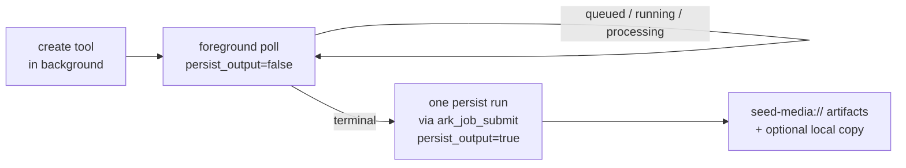

# Polling and artifacts

How to poll asynchronous provider tasks, what the persistence layer does with finished outputs, and how to recover or export them. Parameters and output fields are in the tool schemas ([API reference](https://byteplus-sa.github.io/ark-mcp/api-reference/)); this file covers behaviour the schemas do not.

## Which poller for which task

| Task ID comes from | Poll | Clean up |
|---|---|---|
| `seedance_create_task` | `gen_task_get` (1-50 IDs per call), `gen_task_list` | `gen_task_cancel_or_delete` |
| `omnihuman_create_task` | `omnihuman_get_task` | `omnihuman_cancel_task` |

**A provider task ID is not an Ark `job_id`.** The create tool's background result carries the provider ID; `ark_job_get` only reports on the job that submitted it.

**Seed TTS has no provider-task polling phase.** `seed_tts_generate` aggregates
HTTP JSONL and persists the complete audio within its required background job.
Read its artifact from `ark_job_get`; do not use `gen_task_get` or resubmit
to obtain the result. There is no live MCP audio stream.

## Two-phase polling



- **Foreground poll, then one persist run.** Poll with `persist_output=false` (the default for `gen_task_get`) for quick status checks. When the task is terminal, run the same poller once through `ark_job_submit` with `persist_output=true` so downloading and storing cannot exhaust the client deadline.
- **`persist_output=true` needs background execution** (`ark_job_submit` or native task augmentation). In a foreground call it returns an error result telling you to use `persist_output=false`.
- **`omnihuman_get_task` defaults to `persist_output=true`**, so a foreground status check must pass `false` explicitly.
- **Never resubmit a create tool to poll.** `queued`, `running` and `processing` are not failures, and a second create call starts a second billed task. After a local timeout, disconnect or client restart, poll the same task ID again.
- **Persistence is cached per task and output.** Concurrent and repeated polls reuse each cached durable copy. Missing or failed generation outputs can be persisted later without copying successful siblings again.
- Local files written by a persist run (`output_dir`, `output_path`) need `OUTPUT_ROOTS` on the server; see [background-job-output.md](background-job-output.md).

```json
{"input": {"tool_name": "gen_task_get",
  "arguments": {"input": {"task_ids": ["<task_id>"], "persist_output": true,
                          "output_dir": "/abs/project/renders/"}}}}
```

## Generation tasks: `gen_task_get`, `gen_task_list`, `gen_task_cancel_or_delete`

These tools serve configured Seedance models and require `BYTEPLUS_MODELARK_API_KEY`. Authenticated callers see tasks owned by their principal; every shared-key member uses the same `shared-team` principal, including for cancellation.

### `gen_task_get`

- **Batch every ID you are waiting on into one call** (1-50, duplicates ignored). Results come back in request order.
- **Per-ID problems never fail the call.** They land in `errors`: `NOT_OWNED` (task created by another principal, or never created through this server), `NOT_FOUND` (the provider has no such task or its model ID has no Seedance binding on this server), or a provider code. Check `errors` as well as each task's own `error`.
- **Statuses:** `queued`, `running`, `succeeded`, `failed`, `cancelled`, `expired`; `unknown` for an unrecognised provider value. Terminal means `succeeded`, `failed`, `cancelled` or `expired`.
- **Stop polling when `all_terminal` is true.** Otherwise wait `recommended_poll_after_ms` (5000) between calls.
- **`queue` (video tasks, queued or running only) is derived from the task's own timestamps.** ModelArk publishes no queue position or ETA; relay `queue.hint` rather than estimating. `expires_at` is when the provider fails an unfinished task; `expires_at_estimated=true` means the 48 h default was assumed.
- **`outputs` is empty until `succeeded`.** Seedance tasks return `video` and, when available, `last_frame`. Each output always keeps its `source_url` (expires in about 24 h); `persistence` is `not_requested`, `persisted` or `failed`.
- **Draft tasks:** a succeeded Seedance Draft reports `draft: true`; pass its `task_id` as `draft_task_id` to `seedance_create_task` within 14 days of `created_at` (7 if created before 2026-10-28 10:00 UTC+8). Retain the ID: `gen_task_list` still covers only seven days.
- **`output_dir`** (stdio only) writes each succeeded task's files as `<artifact_id>.<ext>` and requires `persist_output=true`. MOV video outputs retain `video/quicktime` and the `.mov` extension, including when their download uses a generic Content-Type.

### `gen_task_list`

- **Window: tasks created in the last 7 days, newest first.** Older tasks cannot be listed, but may still answer `gen_task_get`.
- **Keep every filter identical while paging, including `page_size`.** A cursor issued for different filters is rejected with an error asking you to repeat the original filters or start without a cursor.
- **Follow `next_cursor` until it is `null`.** A page can hold fewer than `page_size` tasks while the cursor is still non-null, because non-local (authenticated HTTP) callers are paged through their owned IDs from the ownership store in slices and tasks outside the filter are skipped. Tasks without a configured Seedance model are also skipped.
- Entries carry no outputs; use `gen_task_get` for those. `task_ids` filters to IDs you own (others are skipped silently).

### `gen_task_cancel_or_delete`

**Destructive. `expected_status` must equal the task's current status** or the call is refused (re-fetch with `gen_task_get` and retry). The handler checks ownership, verifies the Seedance model binding and task status, then issues the provider DELETE.

| Current status | Allowed | Effect |
|---|---|---|
| `queued` | `mode=cancel`, `expected_status=queued` | becomes `cancelled`; cannot be resumed |
| `succeeded`, `failed`, `expired` | `mode=delete`, matching `expected_status` | removes the task record; outputs are no longer retrievable through `gen_task_get`, so **persist first** |
| `running` | none | cannot be cancelled or deleted |
| `cancelled` | none | cannot be deleted |

A mode that does not fit `expected_status` (cancel with `succeeded`, delete with `queued`) is rejected before any provider call.

## OmniHuman: `omnihuman_get_task`, `omnihuman_cancel_task`

- **Statuses:** `queued`, `running`, `succeeded`, `failed`, `canceled` (single l), `expired` (the provider dropped the task; resubmit), `not_found` (unknown, or older than 12 h; the provider keeps tasks 12 h).
- **Poll about every 10 s** until `succeeded`, then use `video.uri` (a `seed-media://` artifact).
- **The provider's `source_url` is valid for only about one hour** (`source_expires_at` is an estimate: first poll plus one hour). Persist promptly; the default `persist_output=true` does so on the first successful poll when run in the background, and later polls return the cached artifact. `persistence` is `not_applicable` for any non-succeeded status.
- **`omnihuman_cancel_task` only cancels a `queued` task.** A started or finished task returns `canceled=false` with a `message`, not an error. Right after creation the provider may reject the ID as invalid: wait a few seconds and retry.

## Artifacts

Persisted outputs are `ArtifactRef`s whose `uri` is a stable `seed-media://artifacts/{artifact_id}`. Keep `persist=true` / `persist_output=true` (the defaults on the creation tools) for anything you need later.
Seed TTS always persists and accepts no `persist` switch. It has no provider
download URL or source expiry to invent; keep its resolved `output_format`
with the artifact, especially for PCM.

### Retention and access

- **Provider URLs expire fast: 2 h for Seed Audio, 24 h for ModelArk image/video, about 1 h for OmniHuman video.** Durable artifacts survive 7 days by default (`ARTIFACT_TTL_SECONDS`; see [environment.md](environment.md)).
- **Artifacts are owner-checked** against the calling principal. Shared-key members can read one another's team artifacts. The `seed-media://artifacts/{artifact_id}` resource needs a canonical UUID and returns the bytes with the right MIME type; in `api_key` mode it checks the fixed team's `artifacts:read` scope.
- **`seed_media_get_artifact` returns the whole file as Base64 in context.** Use it only for small files or remote (HTTP) deployments with no shared filesystem; on stdio prefer the export tool or a local `output_path`.
- **`seed_media_export_artifact` is stdio only.** Without `destination_path` it returns the artifact's path inside the store (`copied=false`), which is only possible when the store is on the local filesystem; with an object-storage backend it errors and asks for a `destination_path`. With `destination_path` (absolute, inside an allowed output root) it writes an atomic copy (`copied=true`). An existing file with different content is replaced only with `overwrite=true`; identical content always succeeds.

### Local output paths

`output_path`, `output_dir` and `save_to` write results straight to disk so the bytes never enter context. The same rules apply to all of them, plus `destination_path` on the export tool:

- **stdio only.** Over HTTP they are rejected.
- **Absolute path inside an allowed output root:** the client's MCP roots, else `OUTPUT_ROOTS`. With neither, path writing is disabled.
- **Validated before any provider call**, so a bad path never costs a billed generation.
- **Need persistence:** `output_path`/`output_dir` require `persist=true` / `persist_output=true`; Seed TTS always persists without a switch.
- **`output_path` ending in `/` is a directory**, files named `<artifact_id>.<ext>`. A directory is required when a call can produce several files: `seedream_generate_image` with `variations > 1` or `max_images > 1`, or `seed_audio_generate` with `variations > 1`.
- **`output_dir`** is the `gen_task_get` equivalent; **`save_to`** (with `overwrite`) writes the answer of `seed_understand` and `seed_audio_understand`.
- **A failed local write never fails the call.** The durable artifact is kept and the `ArtifactRef` reports `local_path` on success or `export_error` on failure. Always read these fields.
- Inside `ark_job_submit` there are no MCP roots, so these options need `OUTPUT_ROOTS` on the server and are otherwise rejected before any provider call; see [background-job-output.md](background-job-output.md).

### Persistence fallbacks: never lose a billed output

When durable storage fails after the store's own download retries, the call still **succeeds** within the fallback bounds below and the `ArtifactRef` carries `persistence_error` (`code`, `message`, `retryable`, `artifact_limit_bytes`, `source_url_expires_at`). **Always check `persistence_error`** on results from Seedream, Seed Audio, Seed TTS and the task pollers.

| `ArtifactRef.id` | Meaning | Recovery |
|---|---|---|
| a UUID | persisted normally | none |
| `provider-url` | `uri` is the temporary provider URL; not stored | `seed_media_persist_url` before the URL expires |
| `inline-fallback` | Base64 bytes in `fallback_data` (Seed Audio, Seed TTS, Seedream `b64_json`), used when no provider URL exists and the payload is within `ARTIFACT_INLINE_FALLBACK_MAX_BYTES` (default 8 MB, 0 disables) | decode `fallback_data`, or use `output_path` to write it locally; storage has no copy |

Above the inline cap a Base64 output that cannot be stored becomes a tool error. Oversized or invalid Base64 is a validation error, not a storage failure. A `provider-url` artifact cannot be written locally (its `export_error` says to persist it first); an `inline-fallback` artifact can.

The artifact store has no file-size cap for generated audio received as
Base64. The `inline-fallback` size cap applies when storage fails. In that
case `persistence_error.artifact_limit_bytes` is null for inline audio
because the store has no size cap for that source.

### `seed_media_persist_url`

Persists a temporary provider URL as a durable artifact, for `provider-url` fallbacks and for task outputs whose `persistence` is `failed`.

- **Pass the artifact's own `media_type`, `mime_type` and `source_expires_at`.** For a task output, use its `source_url` and role (video `video/mp4`, `last_frame` image).
- **Only trusted BytePlus provider hosts are accepted**, through the same downloader, host allowlist, redirect checks and size limits as generation-time persistence. Anything else is rejected, so it cannot be used to fetch arbitrary URLs.
- **Retry before the source expires.** A failure returns an error with the persistence code and `retryable`; a non-retryable code such as a size-limit breach will not succeed on retry (see `artifact_limit_bytes`).
- In `api_key` mode it checks the fixed team's `media:upload` scope. It is not idempotent: each success creates a new artifact.

For model, limit and env details see [models-and-limits.md](models-and-limits.md) and [environment.md](environment.md); for end-to-end flows see [workflows.md](workflows.md).
