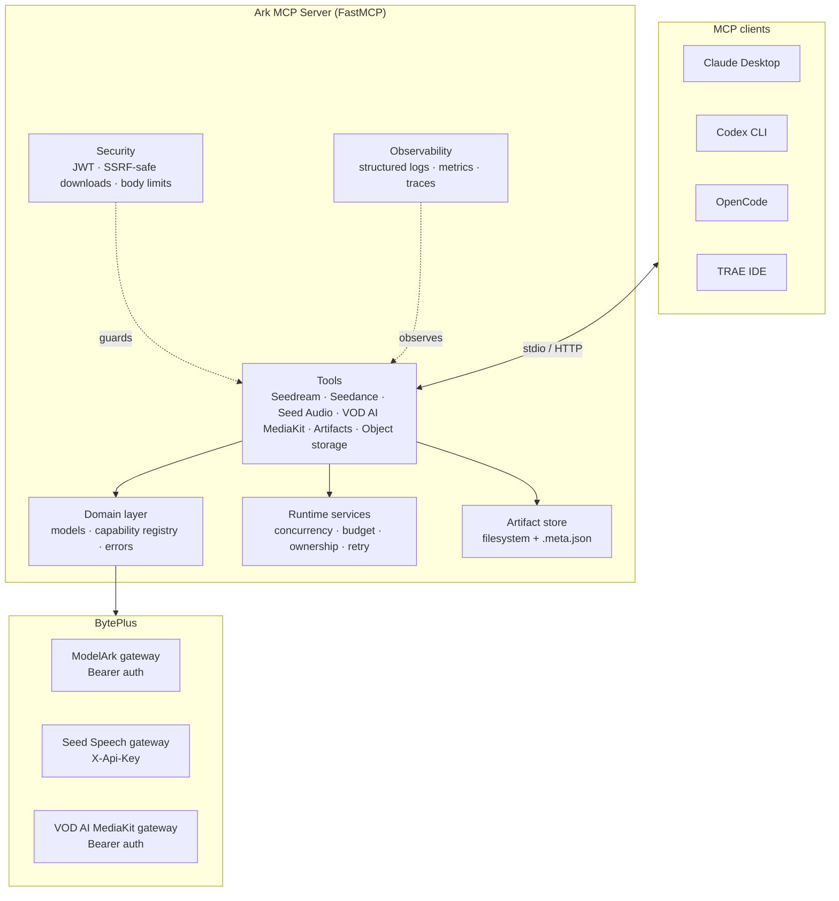
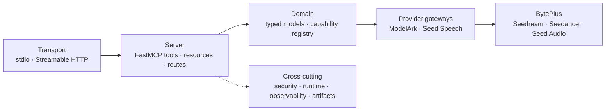
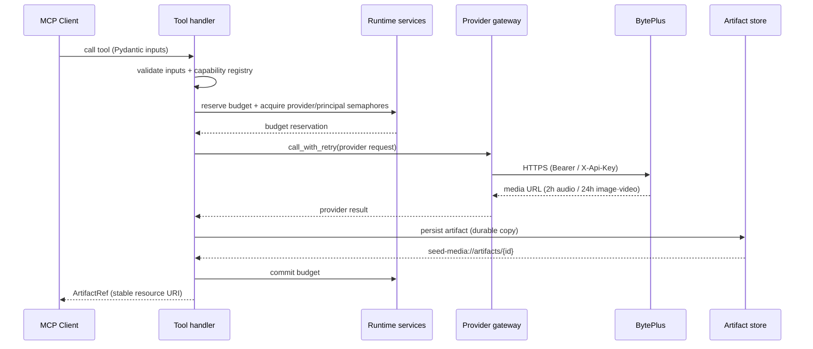

# Ark Seed Multimodal MCP Server

A Python [Model Context Protocol](https://modelcontextprotocol.io) server
built on [FastMCP](https://gofastmcp.com) that exposes BytePlus multimodal
generation through a typed, safe tool surface.

> **Upgrading from 0.1.x?** 0.2.0 consolidates the tool surface and removes
> the old per-model, per-variation and per-operation tools with no
> compatibility layer. See the [migration guide](docs/migration-0.2.md).

## What It Does

The server provides a conditional MCP tool surface across several BytePlus
products plus artifact access and an optional media upload helper:

| Product | Tools | Description |
|---|---|---|
| **Seed Audio** | `seed_audio_generate` | Background-task full-scene audio generation through Seed Speech; one clip or 1-5 parallel variations |
| **Seedream** | `seedream_generate_image` | One background-task image tool through ModelArk: text-to-image, reference editing, point/box edits, transparency-preserving PNG edits (5.0 Pro), provider batches, 1-10 parallel variations, and `dry_run` request and cost previews |
| **Seedance** | `seedance_create_task` | One background-task video tool for every configured Seedance model (2.0, 2.5 by default, and whitelist-only 2.5 Premium with 4K when `BYTEPLUS_MODELARK_SEEDANCE_2_5_PREMIUM_ENABLED=true`): pick the model from `ark_list_models(kind='video')`, create 1-5 variations, use Draft mode on 2.5, or `dry_run` for a free request and cost preview; poll with the shared generation task tools |
| **Hyper3D / Hitem3d** | `hyper3d_create_task`, `hitem3d_create_task` | Background-task 3D submission through ModelArk; poll with the shared generation task tools (gated by `BYTEPLUS_MODELARK_3D_ENABLED`, disabled by default) |
| **Generation tasks** | `gen_task_get`, `gen_task_list`, `gen_task_cancel_or_delete` | One lifecycle for every ModelArk generation task (Seedance video and 3D): batched status checks (1-50 IDs) with derived queue timing and optionally background output persistence, cursor-paged listing of your own tasks, and guarded cancel/delete |
| **OmniHuman 2.0** | `omnihuman_create_task`, `omnihuman_get_task`, `omnihuman_cancel_task` | Image + audio to talking-avatar video through BytePlus Vision AI; background-task submission, polling with durable video persistence, and queue cancel (gated by `BYTEPLUS_OMNIHUMAN_ENABLED` and `BYTEPLUS_CV_API_KEY`, disabled by default) |
| **Seed 2.1 Understanding** | `seed_understand` | Background-task video/image understanding and reasoning through ModelArk Chat Completions; always thinks, returns only the final answer, enforces JSON Schemas, and can save the answer to a local file |
| **Seed Audio Understanding** | `seed_audio_understand` | Background-task audio understanding (transcription, translation, speaker/emotion analysis, summaries, Q&A) through ModelArk Chat Completions `input_audio`; model set by `SEED_AUDIO_UNDERSTANDING_MODEL` (default `seed-2-0-lite-260428`), same thinking, JSON Schema, and `save_to` controls as `seed_understand` |
| **Speech-to-Text** | `speech_to_text` | Background-task audio transcription through Seed Speech ASR (HTTP) |
| **VOD AI MediaKit** | `vod_enhance_video` | Submit asynchronous AI video upscaling/enhancement with fast, standard, or professional tiers and target resolutions from 240p to 8K |
| **VOD AI MediaKit Transcode** | `vod_transcode_video` | Submit async video transcoding (codec, container, resolution, bitrate, frame rate) |
| **VOD AI MediaKit Subtitles** | `vod_add_subtitles`, `vod_remove_subtitles` | Burn SRT/VTT/ASS or inline cues into video, or remove hardcoded subtitles and recognized on-screen text |
| **VOD Audio Separation** | `vod_separate_audio` | Submit voice + background (or voice + music + sfx) audio separation via the VOD AI MediaKit (`separate-voice`) |
| **VOD task polling** | `vod_get_task` | One poller for every `vod_*` task: pass the `task_id` and `operation` the create tool returned; normalized status and outputs with optionally background durable persistence |
| **Private Asset Library** | `ark_asset_group_ensure`, `ark_asset_group_list`, `ark_asset_create`, `ark_asset_list`, `ark_asset_update`, `ark_asset_verification_start`, `ark_asset_verification_result`, `ark_asset_delete` | Manage Seedance Advanced Creation Rights assets (virtual portraits, verified real people) with BytePlus AK/SK; reference them as `asset://<id>` in Seedance |
| **Artifacts** | `seed_media_get_artifact`, `seed_media_export_artifact`, `seed_media_persist_url` | Retrieve persisted media inline by artifact ID, locate/copy it to a local path without Base64 round-trips, or durably persist a provider URL whose storage failed |
| **Object storage** (optional) | `media_upload`, `media_presign` | Background-task upload of 1-50 Base64 or local-file media items to TOS or S3 with per-item results; foreground URL renewal for 1-100 object keys without re-uploading |
| **Background jobs** | `ark_job_capabilities`, `ark_job_submit`, `ark_job_get`, `ark_job_cancel` | Ordinary MCP tools and the default way to submit and manage long-running work; no task-augmented execution required |

Key features:

- **Model discovery** - `ark_list_models` reports configured models and the
  tools serving them. Understanding modalities describe the named tool:
  `seed_understand` takes images/videos; `seed_audio_understand` takes audio
  only, with a server-configured model.
- **Cached account pricing** - with AK/SK configured, discovery includes fresh
  catalog prices without making a provider call. Image and understanding cost
  estimates use recognized catalog rates, with built-in fallbacks.
- **Large audio inputs** - audio understanding supports Files API delivery for
  oversized URLs and video soundtracks, with temporary-upload cleanup.
- **Organization self-hosting** - the [Compose kit](docs/self-hosting.md)
  packages TLS ingress, JWT authentication, internal Redis, and spending controls.
- **Durable artifacts** — generated media is persisted locally so MCP
  resources remain usable after known provider URL lifetimes (2h audio, 24h
  ModelArk image/video); VOD MediaKit persistence is best-effort and capped at
  200 MiB, and completed enhancement URLs have a confirmed 24-hour lifetime
- **Billed outputs are never dropped** — downloads are retried; if storage
  still fails, the result returns the provider URL (or inline bytes) with a
  `persistence_error` instead of an error, recoverable with
  `seed_media_persist_url`
- **Local output paths** — on stdio, `output_path` / `output_dir` / `save_to`
  write results straight into the client's MCP roots (or `OUTPUT_ROOTS`) with
  symlink-safe, no-silent-overwrite writes
- **Parallel variations** — generate N independent variations in a single
  call, partial failures captured per variation with the failure phase
- **Per-variation seeds** — Seedream supports reproducible variations: with
  `variations > 1`, `seed` is the base seed and variation *i* uses `seed + i`
- **Typed inputs** — Pydantic models validate all inputs before spending
  quota; unsupported combinations are rejected at the MCP layer
- **Timeout-safe long operations** — generation, transcription, large upload,
  and provider task-submission tools run in the background through the ordinary
  `ark_job_*` tools by default, or native MCP task augmentation on clients that
  support it; completed-output retrieval also supports background execution
  when persistence may require a large download
- **Model capability registry** — logical model families map to
  operator-configured model IDs; validates resolutions, formats, and
  batch support per model
- **Security** — DNS-pinned SSRF-safe downloads, tenant/principal ownership,
  scoped JWT auth for network HTTP, Host/Origin protection, and body limits
- **Runtime controls** — shared provider/principal concurrency, daily budget
  reservations, safe retries, task ownership, readiness with optional provider
  health checks, per-IP HTTP rate limiting, metrics, and tracing
- **1,155 offline tests** — unit, contract, integration, HTTP security, E2E, and
  MCP conformance with 86% combined statement/branch coverage

## Supported Input Modalities

All input media is validated through an SSRF-safe URL policy and size-checked
Base64 before reaching the provider. The table below shows what each tool
accepts as reference input:

| Tool | Modality | URL | Base64 | Speaker ID | Roles | Max | Constraints |
|---|---|:---:|:---:|:---:|---|:---:|---|
| `seedream_generate_image` | Image | ✓ | ✓ | — | reference | 10 PRO / 14 LITE·4X | — |
| `seedance_create_task` (2.0 models) | Image | ✓ | ✓ | — | `first_frame` · `last_frame` · `reference_image` | 9 | — |
| `seedance_create_task` (2.0 models) | Video | ✓ | — | — | `reference_video` | 3 | URL only |
| `seedance_create_task` (2.0 models) | Audio | ✓ | ✓ | — | `reference_audio` | 3 | Not sole input |
| `seedance_create_task` (2.5 models) | Image | ✓ | ✓ | — | `first_frame` · `last_frame` · `reference_image` | 30 | — |
| `seedance_create_task` (2.5 models) | Video | ✓ | — | — | `reference_video` | 10 | URL only |
| `seedance_create_task` (2.5 models) | Audio | ✓ | ✓ | — | `reference_audio` | 10 | May be the sole input |
| `seed_audio_generate` | Audio | ✓ | ✓ | ✓ | — | 3 | Exclusive w/ image |
| `seed_audio_generate` | Image | ✓ | ✓ | — | — | 1 | Exclusive w/ audio |

> Variations are a field on the base tools (`variations` on
> `seedream_generate_image`, `seed_audio_generate`, and
> `seedance_create_task`), so they accept the same input modalities and limits
> as a single call.

> [!NOTE]
> **Video references must be pre-hosted.** `seedance_create_task` accepts
> video references as a **public HTTPS URL only** — there is no inline Base64
> option. Run `media_upload` in the background through `ark_job_submit` (or MCP
> task metadata on a task-capable client) to upload Base64 or a local file path
> (stdio only) to object storage (TOS or S3). Retrieve its presigned HTTPS GET
> URL from the terminal `ark_job_get.result` (or `tasks/get` response), then run
> `seedance_create_task` through the same supported background path.
> Alternatively, host the video on
> your own accessible HTTPS endpoint. The URL must resolve to
> a public IP (private/loopback/link-local addresses are rejected by the SSRF
> policy). `media_upload` requires TOS or S3 credentials; see [Configuration](docs/configuration.md).

## Architecture

The server uses dedicated provider gateways behind one normalized domain layer, a
lifespan-owned runtime for concurrency/budget/ownership, and a durable
artifact store. See [docs/architecture.md](docs/architecture.md) for the full
overview.

**Components**



**Layered view**



**Request sequence (a billable generate call)**



## Quick Start

```bash
# Clone the repository
git clone <repo-url> ark-mcp
cd ark-mcp

# Install dependencies
uv sync

# Configure credentials
cp .env.example .env
# Edit .env and fill in your BytePlus API keys

# Run the server
make start

# Or validate your environment configuration
make check-env
```

## Configuration

Edit `.env` with your BytePlus credentials:

```dotenv
BYTEPLUS_MODELARK_API_KEY=your_modelark_key
BYTEPLUS_SEED_SPEECH_API_KEY=your_seed_speech_key  # pragma: allowlist secret
BYTEPLUS_VOD_MEDIAKIT_API_KEY=your_vod_mediakit_key
BYTEPLUS_CV_API_KEY=your_vision_ai_key
BYTEPLUS_OMNIHUMAN_ENABLED=true
SEEDREAM_DEFAULT_MODEL=dola-seedream-5-0-pro-260628
SEEDANCE_DEFAULT_MODEL=dreamina-seedance-2-5-260628
```

> [!IMPORTANT]
> **Upgrading:** `SEEDANCE_DEFAULT_MODEL` now defaults to Seedance 2.5. If
> `SEEDANCE_MODEL_BINDINGS` lists only a Seedance 2.0 model, set
> `SEEDANCE_DEFAULT_MODEL` to that ID (or add a 2.5 binding), or the server
> fails at startup. See [Configuration](docs/configuration.md#seedance-default-model-upgrade-note).

If a credential is absent, the server skips registering that product's
tools. `seed_media_get_artifact`, `seed_media_export_artifact`, and
`seed_media_persist_url` are always available, provider tools appear only
when their credentials are configured, `media_upload` and
`media_presign` appear
only when object storage credentials (TOS or S3) are configured, and
`speech_to_text` appears only when `BYTEPLUS_SEED_SPEECH_API_KEY` is set.
`vod_enhance_video`, `vod_transcode_video`, `vod_add_subtitles`,
`vod_remove_subtitles`, `vod_separate_audio`, and `vod_get_task` appear only when
`BYTEPLUS_VOD_MEDIAKIT_API_KEY` is set. `omnihuman_create_task`,
`omnihuman_get_task`, and `omnihuman_cancel_task` appear only when
`BYTEPLUS_OMNIHUMAN_ENABLED=true` and `BYTEPLUS_CV_API_KEY` is set.

See [Configuration](docs/configuration.md) for the full environment
variable reference.

## Using with MCP Clients

Long operations always run in the background. By default, submit them with
ordinary calls to `ark_job_capabilities`, `ark_job_submit`, `ark_job_get`, and
`ark_job_cancel` — MCP task support is still rare, and any client that reports
task augmentation as unsupported rejects `execution.taskSupport="required"`
outright. A client with MCP task support can instead call the original tools as
task-augmented requests and retrieve output through `tasks/get`. Both paths
enqueue the same FastMCP Docket worker and preserve the same typed tool result,
ownership, scope, concurrency, and replay safeguards.

Both paths are tested in-process, over subprocess stdio, and over authenticated
Streamable HTTP with the locked FastMCP 4.0.x runtime. The ordinary path uses
standard MCP tool calls and does not require a client-specific task transport.
The named desktop/IDE snippets below remain connection templates because exact
client releases and tool-selection behavior can change. See the
[background execution workflows](docs/integration-guide.md#background-execution).

The server runs as a `stdio` process. Configure it in your MCP client:

### Claude Desktop

```json
{
  "mcpServers": {
    "ark-seed": {
      "command": "uv",
      "args": ["--directory", "/path/to/ark-mcp", "run", "python", "-m", "ark_mcp"],
      "env": {
        "BYTEPLUS_MODELARK_API_KEY": "your_modelark_key",
        "BYTEPLUS_SEED_SPEECH_API_KEY": "your_seed_speech_key"
      }
    }
  }
}
```

### Codex CLI

Codex reads MCP servers from `~/.codex/config.toml` (global) or
`.codex/config.toml` (project-scoped, trusted projects). The format is TOML
with one `[mcp_servers.<name>]` table per server:

```toml
[mcp_servers.ark-seed]
command = "uv"
args = ["--directory", "/path/to/ark-mcp", "run", "python", "-m", "ark_mcp"]

[mcp_servers.ark-seed.env]
BYTEPLUS_MODELARK_API_KEY = "your_modelark_key"
BYTEPLUS_SEED_SPEECH_API_KEY = "your_seed_speech_key"
```

### OpenCode

OpenCode reads MCP servers from `opencode.json` / `opencode.jsonc` at the
project root, or `~/.config/opencode/opencode.json` globally. Use the
top-level `mcp` key with `type: "local"` and `command` as an array:

```json
{
  "$schema": "https://opencode.ai/config.json",
  "mcp": {
    "ark-seed": {
      "type": "local",
      "command": ["uv", "--directory", "/path/to/ark-mcp", "run", "python", "-m", "ark_mcp"],
      "enabled": true,
      "environment": {
        "BYTEPLUS_MODELARK_API_KEY": "your_modelark_key",
        "BYTEPLUS_SEED_SPEECH_API_KEY": "your_seed_speech_key"
      }
    }
  }
}
```

**Shared server (multiple agents).** `stdio` starts one server process per
client, so background jobs (`ark_job_*`) are process-local and cannot be polled
across agents. To share them, run one loopback HTTP server in local auth mode
(`make shared-http`) and connect every client over HTTP instead:

```json
{
  "$schema": "https://opencode.ai/config.json",
  "mcp": {
    "ark-seed": {
      "type": "remote",
      "url": "http://127.0.0.1:3000/mcp",
      "oauth": false,
      "timeout": 600000
    }
  }
}
```

See [docs/transports.md](docs/transports.md) for the caveats (restart loses
in-memory jobs; Redis retention is single-replica).

### TRAE IDE

TRAE uses the standard `mcpServers` JSON shape, added either via
**Settings → MCP → Add → Manual** in the IDE, or declared in a project-level
`.trae/mcp.json` (enable project-level MCP in Settings → MCP). The
`${workspaceFolder}` variable resolves to the project root:

```json
{
  "mcpServers": {
    "ark-seed": {
      "command": "uv",
      "args": ["--directory", "${workspaceFolder}", "run", "python", "-m", "ark_mcp"],
      "env": {
        "BYTEPLUS_MODELARK_API_KEY": "your_modelark_key",
        "BYTEPLUS_SEED_SPEECH_API_KEY": "your_seed_speech_key"
      }
    }
  }
}
```

> The same `mcpServers` JSON can be pasted directly into TRAE's **Manual
> configuration** window if you already run this server in another IDE.

### TRAE Work

[TRAE Work](https://www.trae.cn/work) is the standalone AI-native workspace
(web, desktop, mobile) with Work and Code dual modes. It reads the same
`mcpServers` JSON shape as TRAE IDE and resolves `${workspaceFolder}` to the
project root. On the desktop app you also pick a **runtime environment** —
**本地 (local)** or **云端 (cloud)** — when adding the server.

Add the server via **Avatar → Settings → MCP → Create → Manual configuration**,
then paste:

```json
{
  "mcpServers": {
    "ark-seed": {
      "command": "uv",
      "args": ["--directory", "${workspaceFolder}", "run", "python", "-m", "ark_mcp"],
      "env": {
        "BYTEPLUS_MODELARK_API_KEY": "your_modelark_key",
        "BYTEPLUS_SEED_SPEECH_API_KEY": "your_seed_speech_key"
      }
    }
  }
}
```

> **Runtime environment.** Pick **本地** to run the server on your machine
> (the repo must be cloned locally, as above). Pick **云端** to run it in a
> TRAE-managed cloud sandbox; in that case sync the repository to the cloud
> environment first (for example via the GitHub integration) so
> `${workspaceFolder}` resolves to a path that actually contains the project.
> See the official
> [TRAE Work MCP guide](https://docs.trae.cn/work/remote-mcp-server).

### Cursor, VS Code, MCP Inspector

See the [Integration Guide](docs/integration-guide.md) for configuration
snippets for Cursor IDE, VS Code MCP extension, and the MCP Inspector.

## Available Make Targets

```bash
make help          # Show all targets
make install       # Install dependencies from uv.lock
make start         # Run the server over stdio
make start-http    # Run the server over Streamable HTTP (localhost:3000)
make dev           # Run in dev mode with auto-reload
make test          # Run the test suite
make lint          # Lint with ruff
make typecheck     # Type-check with mypy
make inspect       # Launch FastMCP inspector
make check-env     # Validate environment configuration
```

## Documentation

| Document | Description |
|---|---|
| [Getting Started](docs/getting-started.md) | Installation, configuration, and first run |
| [Migrating to 0.2.0](docs/migration-0.2.md) | Removed 0.1.x tools and their replacements |
| [Architecture](docs/architecture.md) | System structure, two-gateway domain layer, request flow |
| [Configuration](docs/configuration.md) | Full environment variable reference |
| [Integration Guide](docs/integration-guide.md) | MCP client setup (Claude, Cursor, VS Code, Inspector) |
| [API Reference](docs/api-reference.md) | Complete tool schemas, inputs, outputs, and examples |
| [Use Cases](docs/use-cases.md) | Common scenarios with example tool calls |
| [Tools](docs/tools.md) | Tool reference with input/output tables |
| [Private Asset Library](docs/assets.md) | Real-person, virtual portrait and copyright assets for Seedance (AK/SK) |
| [Security](docs/security.md) | Consolidated security model (auth, SSRF, body limits) |
| [Runtime](docs/runtime.md) | Concurrency, budget, ownership, retry |
| [Observability](docs/observability.md) | Structured logging, metrics, tracing |
| [Models](docs/models.md) | Model capability registry and validation |
| [Artifacts](docs/artifacts.md) | Durable artifact lifecycle and store |
| [Transports](docs/transports.md) | stdio vs HTTP deployment |
| [Deployment](docs/deployment.md) | Container, Kubernetes, and remote HTTP deployment |
| [Troubleshooting](docs/troubleshooting.md) | Common errors and fixes |

## Project Layout

```text
ark-mcp/
├── src/ark_mcp/
│   ├── server.py              # Deterministic FastMCP factory and registration
│   ├── __main__.py            # Entry point (truststore injection)
│   ├── runtime.py             # Lifespan-owned stores, limits, budgets, ownership
│   ├── config/                # Pydantic Settings, model capability registry
│   ├── domain/                # ArtifactRef, errors, media, models
│   ├── providers/             # ModelArk + Seed Speech gateways and adapters
│   ├── tools/                 # 9 tool handlers + parallel helpers + cost estimation
│   ├── artifacts/             # Tenant-aware filesystem artifact store
│   ├── observability/         # Structured logging and Prometheus metrics
│   └── security/              # JWT, URL/media policy, safe downloader, HTTP limits
├── tests/
│   ├── unit/                  # Model validators, URL policy, media policy, helpers
│   ├── contract/              # Provider gateway + adapter contract tests
│   ├── integration/           # Tool handler, HTTP security, MCP conformance
│   └── e2e/                   # In-process FastMCP client tests
├── docs/                      # User and contributor documentation
├── plans/                     # Implementation plans
├── scripts/                   # Verification and smoke test scripts
├── fastmcp.json               # Declarative server configuration
├── Makefile                  # Task runner
└── pyproject.toml             # Project metadata and dependencies
```

## Tech Stack

- [Python 3.12+](https://www.python.org/) on [uv](https://docs.astral.sh/uv/)
- [FastMCP v4](https://gofastmcp.com/) — MCP server framework
- [httpx](https://www.python-httpx.org/) — async HTTP client
- [Pydantic v2](https://docs.pydantic.dev/) — typed models and validation
- [pydantic-settings](https://pydantic.dev/docs/validation/latest/concepts/pydantic_settings/) — environment configuration
- [Starlette](https://www.starlette.io/) — HTTP middleware, body limits, and responses
- [prometheus-client](https://github.com/prometheus/client_python) — `/metrics` and Prometheus exposition
- [cachetools](https://github.com/tkem/cachetools) — TTL caching for provider responses and principal limits
- [truststore](https://truststore.readthedocs.io/) — macOS system certificate injection
- [respx](https://github.com/lundberg/respx) — HTTP mocking for contract tests

## License

See the project configuration for license details.

## Status

All three provider surfaces and both transports are implemented. The local
release gate passes 631 offline tests at 88% branch coverage, Ruff formatting
and lint, strict mypy, Bandit/secret scans, and package build. Dependency audit
and container health are enforced by CI. Remote HTTP requires JWT configuration
and is intentionally fail-closed.
