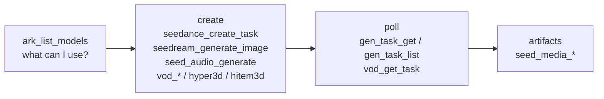

# Migrating to 0.2.0

**0.2.0 consolidates the tool surface.** One tool per product capability
replaces the per-model, per-variation and per-operation tools of 0.1.x. With
every service enabled, `tools/list` now returns **38 tools**. **There is no
compatibility layer**: clients, prompts, skills and dashboards that name a
removed tool must switch to its replacement.

## What to do first

1. **Call `ark_list_models`** to see the bound models, their limits, and the
   tool that serves each one. Model IDs passed to create tools must match a
   bound ID exactly; unknown IDs fail with a did-you-mean suggestion.
2. **Rename tool calls** using the table below.
3. **Grant the new scopes** `gen:read` and `gen:delete` (JWT mode only).
4. **Update dashboards** keyed on the `tool` label of
   `ark_mcp_tool_requests_total` / `ark_mcp_tool_duration_seconds`.

## Old to new tools

### Seedance (video)

| 0.1.x tool | 0.2.0 replacement |
|---|---|
| `seedance_create_task` (2.0) | `seedance_create_task` with `model` set to the 2.0 ID |
| `seedance_2_5_create_task` | `seedance_create_task` (2.5 is the default model) |
| `seedance_2_5_premium_create_task` | `seedance_create_task` with `model` set to the Premium ID (still gated by `BYTEPLUS_MODELARK_SEEDANCE_2_5_PREMIUM_ENABLED`) |
| `seedance_create_task_variations`, `seedance_2_5_create_task_variations`, `seedance_2_5_premium_create_task_variations` | `seedance_create_task` with `variations` (and optional `variation_prompts`) |
| `seedance_get_task`, `seedance_get_tasks` | `gen_task_get` (`task_ids`, 1-50) |
| `seedance_list_tasks` | `gen_task_list` (`page_size`, `cursor`, `status`, `model`) |
| `seedance_cancel_or_delete_task` | `gen_task_cancel_or_delete` |

- **New:** `dry_run=true` returns the provider request(s) with media URLs
  redacted and an estimated cost, without submitting.
- **One output shape:** `tasks[]` (one entry per submission), `submitted`,
  `failed`, `recommended_poll_after_ms`.
- **Default model changed:** `SEEDANCE_DEFAULT_MODEL` now defaults to
  `dreamina-seedance-2-5-260628`. Set it explicitly to keep 2.0 as the default.

### 3D

| 0.1.x tool | 0.2.0 replacement |
|---|---|
| `hyper3d_get_task`, `hitem3d_get_task` | `gen_task_get` |
| `hyper3d_list_tasks`, `hitem3d_list_tasks` | `gen_task_list` |
| `hyper3d_cancel_or_delete_task`, `hitem3d_cancel_or_delete_task` | `gen_task_cancel_or_delete` |

The create tools `hyper3d_create_task` and `hitem3d_create_task` are
unchanged.

### Seedream (images)

| 0.1.x tool | 0.2.0 replacement |
|---|---|
| `seedream_edit_image` | `seedream_generate_image` with `images`, plus optional `point` / `bbox` |
| `seedream_generate_image_variations` | `seedream_generate_image` with `variations`; `base_seed` is now `seed` |

- **New:** `background="transparent"` (Seedream 5.0 Pro): edits exactly one PNG input that already has transparent pixels and keeps the transparency (PNG output). It does not remove the background of an opaque image.
- **New:** `dry_run=true`.
- **`max_images` and `variations > 1` are mutually exclusive.**
- **`output_path` replaces `output_dir`;** it must be a directory ending in
  `/` when several images are produced.

### Seed Audio

| 0.1.x tool | 0.2.0 replacement |
|---|---|
| `seed_audio_generate_variations` | `seed_audio_generate` with `variations` (1-5) and optional `variation_prompts` |

With `variations > 1`, `artifact`, `duration_seconds` and
`billing_duration_seconds` are null and `summary` carries the per-variation
results.

### VOD AI MediaKit

| 0.1.x tool | 0.2.0 replacement |
|---|---|
| `vod_get_enhancement_task` | `vod_get_task` with `operation="enhance"` |
| `vod_get_transcode_task` | `vod_get_task` with `operation="transcode"` |
| `vod_get_audio_separation` | `vod_get_task` with `operation="separate_audio"` |
| `vod_get_subtitle_addition_task` | `vod_get_task` with `operation="add_subtitles"` |
| `vod_get_subtitle_removal_task` | `vod_get_task` with `operation="remove_subtitles"` |

Every `vod_*` create tool echoes the `operation` value to pass back.

### Object storage

| 0.1.x tool | 0.2.0 replacement |
|---|---|
| `media_upload` (one file), `media_upload_batch` | `media_upload` with `items` (1-50) |
| `media_presign` (one key), `media_presign_batch` | `media_presign` with `object_keys` (1-100) |

**Per-item failures no longer raise.** They are reported in `items[].error`;
check `failed` in every response.

### Private asset library

| 0.1.x tool | 0.2.0 replacement |
|---|---|
| `ark_asset_group_create` | `ark_asset_group_ensure` (reuses the group with the exact subject name, or creates it) |
| `ark_asset_group_get` | `ark_asset_group_list` with `group_ids` |
| `ark_asset_get` | `ark_asset_list` with `asset_ids` (IDs or `asset://` references) |
| `ark_asset_group_update` | `ark_asset_update` with `group_id` |
| `ark_asset_group_delete` | `ark_asset_delete` with `group_id` |

- **`ark_asset_delete` refuses a non-empty group unless `cascade=true`**,
  because deleting a group also deletes its assets.
- `ark_asset_update` and `ark_asset_delete` take exactly one of `asset_id`
  or `group_id`.
- `ark_asset_create` reports `group_created_empty` when it created a subject
  group but every source failed.

## Auth scopes (JWT mode)

| Removed | Replacement |
|---|---|
| `seedance:read`, `hyper3d:read`, `hitem3d:read` | `gen:read` |
| `seedance:delete`, `hyper3d:delete`, `hitem3d:delete` | `gen:delete` |

**Until the identity provider grants `gen:read` and `gen:delete`, those
principals cannot poll or cancel tasks.** Ownership checks are unchanged: a
`gen:read` token still sees only the tasks it created. See
[security.md](security.md) for the full scope table.

## Observability

The `tool` label on `ark_mcp_tool_requests_total` and
`ark_mcp_tool_duration_seconds` follows the new names. **The merged
`seedance_create_task` no longer separates 2.0, 2.5 and Premium by label**;
use the `model` field in logs to split them.
