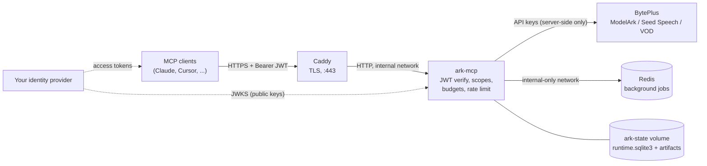

# Self-Hosting for an Organization

This guide is for an organization that runs **its own** Ark Seed MCP server for
its own users, with its own BytePlus account. Each organization deploys one
instance; organizations never share a server, keys, or data.

The same codebase also runs **locally** on a single user's machine over
`stdio`. Most organizations use both: a hosted server for the team, and local
runs for developers and evaluation.

## Choosing hosted or local

| | Local (`stdio`) | Organization-hosted (HTTP + JWT) |
|---|---|---|
| Who holds BytePlus keys | Every user, in their MCP client config | Only the server |
| Sign-in | None (single trusted local user) | Your identity provider (JWT) |
| Identity and access control | One local identity; no JWT scopes | Per-user JWT scopes and spend caps |
| Jobs survive the user closing their client | No (unless `make shared-http`) | Yes |
| Read and write local files (`output_path`, `save_to`, file-path uploads) | Yes | No; upload with `media_upload` or Base64, then download results |
| Infrastructure | None | One host, a DNS name, an identity provider |
| Best for | Developers, trials, one or two power users | Team or company rollout, non-technical users |

For local setup see [Getting Started](getting-started.md). The rest of this
page covers the hosted server.

## Architecture



- Only Caddy is published to the network. `ark-mcp` and Redis have no
  published ports; Redis sits on a network with no outside route.
- BytePlus keys live only in the server's environment. Users never see them
  and cannot pass keys as tool arguments.
- Each user is identified by the JWT `sub` claim plus a tenant claim. Tasks,
  artifacts, uploads, and background jobs are owned by that identity; one user
  cannot read another user's results.

## Deploy with Docker Compose

The kit lives in [`deploy/compose/`](../deploy/compose/).

**Prerequisites**

- A Linux host with Docker Engine and Docker Compose v2. 2 vCPU and 4 GB RAM
  suits most organizations; see [Sizing](#sizing).
- A DNS name (for example `mcp.example.com`) pointing at the host, with ports
  80 and 443 reachable for automatic TLS. For an internal-only name, see
  [TLS for internal hostnames](#tls-for-internal-hostnames).
- An identity provider that can issue access tokens as described in
  [Identity provider](#identity-provider).
- BytePlus API keys for the products you want to offer.

**Steps**

```bash
cd deploy/compose
cp .env.example .env
```

Edit `.env` and set at least `MCP_PUBLIC_HOST`, the four `MCP_JWT_*` /
`MCP_TENANT_CLAIM` values, the BytePlus keys you use, `REDIS_PASSWORD`, and
`FASTMCP_TASKS_ENCRYPTION_KEY`. Generate each secret with:

```bash
openssl rand -hex 32
```

Then start the stack:

```bash
docker compose up -d --build
```

Check it:

```bash
docker compose ps
```

```bash
curl -fsS https://mcp.example.com/health
```

A request to `https://mcp.example.com/mcp` without a token must return `401`.

### What the kit enforces

`compose.yaml` pins these values so a mistake in `.env` cannot weaken them:

| Setting | Value | Why |
|---|---|---|
| `MCP_TRANSPORT` / `MCP_AUTH_MODE` | `http` / `jwt` | Every request needs a valid token. |
| `MCP_ALLOWED_HOSTS` | `${MCP_PUBLIC_HOST},ark-mcp` | Rejects requests for other hostnames. |
| `RATE_LIMIT_TRUST_PROXY_HEADERS` | `true` | Rate limits apply per real client IP. Safe because Caddy is the only way in and overwrites `X-Forwarded-For`. |
| `FASTMCP_DOCKET_URL` | password-protected Redis on the internal network | Jobs survive restarts. |
| Container | read-only root filesystem, all capabilities dropped, `no-new-privileges`, non-root UID 1001 | Limits damage if the process is compromised. |

Caddy returns `404` for `/metrics` and `/ready` from outside. Scrape metrics
from inside the Docker network at `http://ark-mcp:3000/metrics`.

### TLS for internal hostnames

Caddy obtains a public certificate automatically when the hostname is publicly
resolvable. For a name that only resolves inside your network, edit
`deploy/compose/Caddyfile` and add one line inside the site block:

- `tls internal` to use Caddy's private CA (clients must trust it), or
- `tls /certs/cert.pem /certs/key.pem` with your own certificate, mounted into
  the `caddy` service.

## Identity provider

The server does not manage users. Your identity provider (Okta, Microsoft
Entra ID, Keycloak, Auth0, or any OAuth 2.0 / OIDC server) issues access
tokens, and the server verifies them against the provider's public keys.

Access tokens must meet all of these:

| Requirement | Detail |
|---|---|
| Signature | RS256, verifiable from `MCP_JWT_JWKS_URI` (must be `https://`) |
| `iss` | Exactly `MCP_JWT_ISSUER` |
| `aud` | Contains `MCP_JWT_AUDIENCE` (for example `ark-mcp`) |
| `exp` | Required; tokens without an expiry are rejected |
| `nbf` | If present, must not be in the future (30 s skew by default) |
| `sub` | The user's stable ID; owns their tasks, artifacts, and budget |
| Tenant claim | The claim named by `MCP_TENANT_CLAIM` (default `tenant_id`), a string. Use a team or department, or one fixed value for the whole organization. |
| Scopes | In `scope` (space-delimited string) or `scp` |

Most providers need a custom claim or claim mapping for the tenant claim, and
a custom API or resource server whose identifier matches `MCP_JWT_AUDIENCE`.

### Connecting clients

Clients that support OAuth discovery can find your provider and sign users in
automatically if you set `MCP_JWT_PROVIDE_DISCOVERY=true`,
`MCP_PUBLIC_BASE_URL=https://<MCP_PUBLIC_HOST>`, and
`MCP_JWT_SCOPES_SUPPORTED`.

Other clients send an access token in the `Authorization` header. For clients
configured with an `mcpServers` JSON file:

```json
{
  "mcpServers": {
    "ark-mcp": {
      "type": "http",
      "url": "https://mcp.example.com/mcp",
      "headers": {"Authorization": "Bearer <access token>"}
    }
  }
}
```

Access tokens expire, so a static header must be refreshed; prefer OAuth
discovery where the client supports it.

## Scopes and roles

Each tool requires one scope. Grant only what each group needs. The tools for a
product exist only when its BytePlus key is configured.

| Scope | Tools |
|---|---|
| `seedream:generate` | Image generation, variations, editing |
| `seedance:create` | Create video tasks with `seedance_create_task` (all generations) |
| `gen:read` / `gen:delete` | Poll/list or cancel/delete Seedance and 3D tasks |
| `seed:audio:generate` | Audio generation and variations |
| `seed:asr:transcribe` | `speech_to_text` |
| `understanding:read` | `seed_understand`, `seed_audio_understand` |
| `hyper3d:create` | Hyper3D text-to-3D tasks |
| `hitem3d:create` | Hitem3D image-to-3D tasks |
| `omnihuman:create` / `omnihuman:read` / `omnihuman:cancel` | OmniHuman 2.0 image-plus-audio video tasks |
| `vod:enhance`, `vod:transcode`, `vod:subtitle:add`, `vod:subtitle:remove`, `vod:extract` / `vod:read` | VOD processing / polling |
| `media:upload` / `media:presign` | Upload reference media and persist provider URLs / mint read URLs |
| `artifacts:read` | Read and download generated artifacts |
| `assets:read` / `assets:write` / `assets:verify` / `assets:delete` | Private asset library (account-wide; see below) |

The background job tools (`ark_job_*`) need no extra scope; submitting a job
requires the target tool's scope.

Suggested roles:

| Role | Scopes |
|---|---|
| Viewer | `artifacts:read`, `gen:read`, `vod:read` |
| Analyst | Viewer plus `understanding:read` (billable model calls) |
| Creator | Viewer plus `seedream:generate`, `seedance:create`, `seed:audio:generate`, `seed:asr:transcribe`, `media:upload`, `media:presign` |
| Video editor | Creator plus `vod:enhance`, `vod:transcode`, `vod:subtitle:add`, `vod:subtitle:remove`, `vod:extract` |
| 3D creator | Creator plus `hyper3d:create`, `hitem3d:create` |
| Avatar video creator | Creator plus `omnihuman:create`, `omnihuman:read`, `omnihuman:cancel` |
| Asset admin | `assets:read`, `assets:write`, `assets:verify`, `assets:delete`, only for administrators |

> **The asset library is account-wide.** `ark_asset_*` tools act on the whole
> BytePlus account, not per user, and include real-person identity
> verification. Users with the asset read/write scopes can see and change account assets.
> Leave `BYTEPLUS_MODELARK_ACCESS_KEY` / `_SECRET_KEY` empty unless you need
> assets or live pricing. Configuring pricing credentials also registers the
> asset tools; grant only the explicit asset scopes administrators need.

## Spend and abuse guardrails

All users share the organization's BytePlus keys, so these controls decide how
much one user, or one leaked token, can spend.

| Variable | Kit default | Effect |
|---|---|---|
| `DAILY_BUDGET_USD` | `25` | Per-user UTC daily cap. `0` only records spend and never blocks. |
| `RATE_LIMIT_RPM` / `RATE_LIMIT_BURST` | `120` / `30` | Requests per minute per client IP. `0` disables. |
| `PRINCIPAL_MAX_CONCURRENCY` | `3` | Concurrent billable calls per user. |
| `PROVIDER_MAX_CONCURRENCY` | `5` | Concurrent billable calls per provider across all users. |

The server logs an `http_guardrails_disabled` warning at startup when an
authenticated HTTP deployment runs with `DAILY_BUDGET_USD` or `RATE_LIMIT_RPM`
switched off.

Budget checks use a coarse cost estimate (see [Runtime](runtime.md#daily-budget--cost-estimation)),
so also set spending alerts or limits in the BytePlus console. Create a
dedicated BytePlus API key for this server so you can rotate or revoke it
without affecting other systems.

## Sizing

The server runs as **one instance**. Ownership, budgets, and execution claims
are in `runtime.sqlite3`, and concurrency limits are in process, so a second
replica would not share them.

Capacity depends on the provider quota, media sizes, and concurrency. Load-test
with the organization's actual workload before setting a user-count target:

- **Your BytePlus quota is usually the ceiling.** Raise
  `PROVIDER_MAX_CONCURRENCY` to match your account's concurrency limits;
  requests above it wait for a free slot.
- **Memory** grows with large inline uploads (request bodies up to 300 MiB).
  Add memory if many users upload video at once.
- **Disk** grows with stored artifacts when `ARTIFACT_BACKEND=filesystem`.
  Use `ARTIFACT_BACKEND=object_storage` with TOS or S3 for heavy video use,
  and tune `ARTIFACT_TTL_SECONDS` (default 7 days).

## Operations

**Backups.** Back up the `ark-state` volume. It holds `runtime.sqlite3`, which
records who owns which task and artifact; losing it cuts users off from their
earlier results. With the filesystem backend it also holds the artifacts.
Keep `FASTMCP_TASKS_ENCRYPTION_KEY` in your secret manager; the Redis job data
is unreadable without it.

**Upgrades.** Pull the new release, then rebuild and restart:

```bash
docker compose up -d --build
```

The application container has a `660s` stop grace period: the default
600-second request timeout plus 60 seconds for cleanup. Compose sends SIGTERM,
then allows this window before forcing termination. If you increase
`BYTEPLUS_REQUEST_TIMEOUT_MS`, also increase `stop_grace_period` in your Compose
override by at least the same amount. This is a bounded drain window, not a
guarantee that every long background workflow finishes. A background job that
had already started a paid provider call is not replayed after a restart; see
[Deployment](deployment.md#background-tasks-in-a-single-replica-deployment).

**Logs and metrics.** Logs are structured JSON on stderr with secrets and
prompts redacted:

```bash
docker compose logs -f ark-mcp
```

Metrics are described in [Observability](observability.md).

**Rotating keys.** Update `.env`, then recreate the container:

```bash
docker compose up -d
```

Settings are read once at startup.

## Security checklist

- [ ] `MCP_PUBLIC_HOST` resolves to this host and serves a valid certificate.
- [ ] `MCP_JWT_ISSUER`, `MCP_JWT_AUDIENCE`, and `MCP_JWT_JWKS_URI` match your
      identity provider exactly.
- [ ] Tokens carry `sub`, the tenant claim, and least-privilege scopes.
- [ ] Asset scopes are granted to administrators only, or the asset keys are unset.
- [ ] `DAILY_BUDGET_USD` and `RATE_LIMIT_RPM` are non-zero, and no
      `http_guardrails_disabled` warning appears in the logs.
- [ ] A dedicated BytePlus key is used, with console spending alerts.
- [ ] `REDIS_PASSWORD` and `FASTMCP_TASKS_ENCRYPTION_KEY` are random and stored
      in a secret manager.
- [ ] `.env` is readable only by the operator account.
- [ ] Only ports 80 and 443 are open on the host.
- [ ] The `ark-state` volume is backed up.

See [Security](security.md) for the full security model and
[Configuration](configuration.md) for every environment variable.

## Validation Status

The Compose configuration and application guardrails have automated checks.
Production TLS certificate issuance, identity-provider login, and Redis restart
recovery across the full three-service stack still need validation on the
deployment host. Do not treat configuration validation as a production load test.
