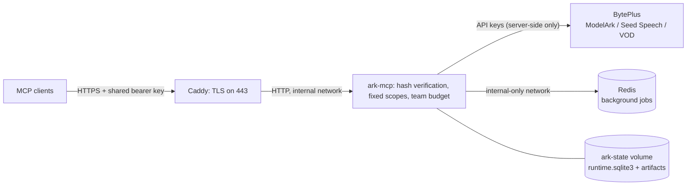

# Self-Hosting for an Organization

This guide is for an organization that runs **its own** Ark Seed MCP server for
its own users, with its own BytePlus account. Each organization deploys one
instance; organizations never share a server, keys, or data.

The same codebase also runs **locally** on a single user's machine over
`stdio`. Most organizations use both: a hosted server for the team, and local
runs for developers and evaluation.

## Choosing hosted or local

| | Local (`stdio`) | Organization-hosted (authenticated HTTP) |
|---|---|---|
| Who holds BytePlus keys | Every user, in their MCP client config | Only the server |
| Sign-in | None (single trusted local user) | One administrator-issued shared MCP key |
| Identity and access control | One local identity; no token scopes | Fixed `shared-team` identity, ordinary tool scopes and team-wide spend cap |
| Jobs survive the user closing their client | No (unless `make shared-http`) | Yes |
| Read and write local files (`output_path`, `save_to`, file-path uploads) | Yes | No; upload with `media_upload` or Base64, then download results |
| Infrastructure | None | One host and a DNS name |
| Best for | Developers, trials, one or two power users | Team or company rollout, non-technical users |

For local setup see [Getting Started](getting-started.md). The rest of this
page covers the hosted server.

For a BytePlus-hosted deployment, the
[Terraform starter](byteplus-terraform.md) provisions the ECS host and retained
disk for this same Compose stack. One deployment can serve a team or an entire
organization; each retains its own configuration, credentials, and state.

## Architecture

The administrator distributes one MCP bearer key privately to trusted members.
The server checks its hash and assigns every caller the same team identity.
The deployment boundaries below match `deploy/compose/compose.yaml`; key
verification is implemented in `src/ark_mcp/security/http_auth.py`.



- Only Caddy is published to the network. `ark-mcp` and Redis have no
  published ports; Redis sits on a network with no outside route.
- BytePlus keys live only in the server's environment. Users never see them
  and cannot pass keys as tool arguments.
- All members use tenant and principal `shared-team`. They share tasks,
  artifacts, uploads, background jobs, budget and principal concurrency,
  including access to one another's permitted results and cancellations.
  There is no per-member attribution, isolation or revocation.

## Deploy with Docker Compose

The kit lives in [`deploy/compose/`](../deploy/compose/).

**Prerequisites**

- A Linux host with Docker Engine and Docker Compose v2. 2 vCPU and 4 GB RAM
  suits most organizations; see [Sizing](#sizing).
- A DNS name (for example `mcp.example.com`) pointing at the host, with ports
  80 and 443 reachable for automatic TLS. For an internal-only name, see
  [TLS for internal hostnames](#tls-for-internal-hostnames).
- A [shared MCP key](#shared-mcp-key) for one trusted team and clients that
  support a privately configured bearer header.
- BytePlus API keys for the products you want to offer.

**Steps**

```bash
cd deploy/compose
cp .env.example .env
```

Edit `.env` and set `MCP_PUBLIC_HOST`, the BytePlus keys you use,
`REDIS_PASSWORD`, and `FASTMCP_TASKS_ENCRYPTION_KEY`. For authentication, set
`MCP_AUTH_MODE=api_key` plus `MCP_API_KEY_SHA256` from the key generator below.
Docker, Compose and Terraform default to `api_key`; Python settings default
to `local`, which is restricted to stdio or loopback HTTP.
Generate the Redis password and snapshot encryption key separately with:

```bash
openssl rand -hex 32
```

Then start the stack:

```bash
docker compose up -d --build
```

Check it:

```bash
docker compose ps
```

```bash
curl -fsS https://mcp.example.com/health
```

A request to `https://mcp.example.com/mcp` without a token must return `401`.

### What the kit enforces

`compose.yaml` sets these defaults and guardrails:

| Setting | Value | Why |
|---|---|---|
| `MCP_TRANSPORT` / `MCP_HOST` | `http` / `0.0.0.0` | Settings reject unauthenticated `local` mode on this bind. |
| `MCP_AUTH_MODE` | `${MCP_AUTH_MODE:-api_key}` | Shared-key auth; `local` is rejected on the container's non-loopback bind. |
| `MCP_ALLOWED_HOSTS` | `${MCP_PUBLIC_HOST},ark-mcp` | Rejects requests for other hostnames. |
| `RATE_LIMIT_TRUST_PROXY_HEADERS` | `true` | Rate limits apply per real client IP. Safe because Caddy is the only way in and overwrites `X-Forwarded-For`. |
| `FASTMCP_DOCKET_URL` | password-protected Redis on the internal network | Jobs survive restarts. |
| Container | read-only root filesystem, all capabilities dropped, `no-new-privileges`, non-root UID 1001 | Limits damage if the process is compromised. |

Caddy returns `404` for `/metrics` and `/ready` from outside. Scrape metrics
from inside the Docker network at `http://ark-mcp:3000/metrics`.

### TLS for internal hostnames

Caddy obtains a public certificate automatically when the hostname is publicly
resolvable. For a name that only resolves inside your network, edit
`deploy/compose/Caddyfile` and add one line inside the site block:

- `tls internal` to use Caddy's private CA (clients must trust it), or
- `tls /certs/cert.pem /certs/key.pem` with your own certificate, mounted into
  the `caddy` service.

## Shared MCP key

Hosted HTTP uses `MCP_AUTH_MODE=api_key`. No login service, user database or
key-management portal is needed. Clients must support a manually configured
bearer header. The server provides no OAuth login or discovery endpoints;
clients that require such a flow are not supported.

On a trusted POSIX machine, from the repository root:

```bash
uv run python scripts/generate_mcp_key.py /private/directory/ark-mcp-team.key
```

Use an existing private directory outside the repository. The command generates
32 random bytes encoded as 64 lowercase hex characters, writes the key into a
new mode-0600 file, and outputs only `MCP_API_KEY_SHA256=<digest>`. It refuses to
overwrite an existing file or symlink and does not load `.env`. Put the emitted
assignment in the server's private `.env`; **do not put the raw key there**.
Keep this configuration root-owned and mode 0600 on the deployment host.
The digest is SHA-256 of the key's ASCII text, excluding the trailing newline.

Privately share the file's key value through your team's secret manager.
Configure each MCP client with the same URL and header:

```json
{
  "mcpServers": {
    "ark-mcp": {
      "type": "http",
      "url": "https://mcp.example.com/mcp",
      "headers": {"Authorization": "Bearer <shared MCP key>"}
    }
  }
}
```

Never use a BytePlus provider key for this purpose. Never put the MCP key in
query parameters, Terraform variables/state, shell arguments, logs, or Git.
The server stores only the configured digest; request tokens still exist in
memory and may appear in encrypted background-task snapshots.

The verifier assigns tenant and principal `shared-team`, with a fixed allowlist
of ordinary generation, understanding, media, artifact, task read and task
cancel/delete scopes. Account-wide `assets:*` and `moderation:*` privileges are
not granted, even if provider administration credentials exist on the server.
No wildcard grants, per-member roles or operator scope override are provided.
Local file input/output remains unavailable over HTTP.

### Rotation and removal

There is one active key and no automatic expiry. Rotate on a schedule, after
exposure, or when a member leaves. Generate a new file, stop accepting new work,
and drain active jobs before replacing `MCP_API_KEY_SHA256` and recreating the
application container. A plain `docker compose restart` does not reload `.env`;
use `docker compose up -d --no-deps --force-recreate ark-mcp`.
For Terraform hosts, use the documented stop/edit/activate procedure instead.
Distribute the new key to all members and verify the old key returns `401`.

The stable team identity keeps ownership and budget history across rotation.
Do not change `FASTMCP_TASKS_ENCRYPTION_KEY`, delete volumes, or replay ambiguous
paid jobs. In-flight requests are not retroactively revoked by changing a file.
Stop the service first for emergency revocation. Clients may need to reconnect.

## Breaking-change migration

The former `MCP_AUTH_MODE=jwt` is rejected at startup. JWT verification and
OAuth discovery have been removed. Retired `MCP_JWT_*`, `MCP_TENANT_CLAIM` and
`MCP_PUBLIC_BASE_URL` settings are not used; remove them from private server
configuration. Configure `api_key` with only the shared-key digest and update
every client to send the new bearer key.

Before upgrading, stop new submissions, drain active work and back up
`runtime.sqlite3`, artifacts and Redis state. Preserve the existing
`FASTMCP_TASKS_ENCRYPTION_KEY`. **There is no automatic ownership transfer:**
data owned by former users or `local` does not become `shared-team` data.
Retain that history and plan any ownership migration separately; do not delete
the database, change the encryption key or replay ambiguous paid jobs to
work around access failures. Key rotation within `api_key` keeps the same owner.

## Fixed team permissions

The shared key always receives the ordinary scopes below. They are enforced
per tool, not selected by a client or assigned through roles. Product tools
still require their server-side credentials and feature flags.

| Scope | Tools |
|---|---|
| `seedream:generate` | Image generation, variations, editing |
| `seedance:create` | Create video tasks with `seedance_create_task` (all generations) |
| `gen:read` / `gen:delete` | Poll/list or cancel/delete Seedance and 3D tasks |
| `seed:audio:generate` | Audio generation and variations |
| `seed:asr:transcribe` | `speech_to_text` |
| `understanding:read` | `seed_understand`, `seed_audio_understand` |
| `hyper3d:create` | Hyper3D text-to-3D tasks |
| `hitem3d:create` | Hitem3D image-to-3D tasks |
| `omnihuman:create` / `omnihuman:read` / `omnihuman:cancel` | OmniHuman 2.0 image-plus-audio video tasks |
| `vod:enhance`, `vod:transcode`, `vod:subtitle:add`, `vod:subtitle:remove`, `vod:extract` / `vod:read` | VOD processing / polling |
| `media:upload` / `media:presign` | Upload reference media and persist provider URLs / mint read URLs |
| `artifacts:read` | Read and download generated artifacts |

The background job tools (`ark_job_*`) need no extra scope; submitting a job
requires the target tool's scope.

> **Account-wide administration is excluded.** The shared key receives no
> `assets:*` or `moderation:*` privileges, even when provider credentials or
> feature flags register those tools. Use a trusted local stdio setup for
> administration, with the relevant provider gates enabled. Leave
> `BYTEPLUS_MODELARK_ACCESS_KEY` / `_SECRET_KEY` empty unless needed for
> account integrations such as pricing or asset-reference preflight.

## Spend and abuse guardrails

All members share the organization's BytePlus keys and one MCP identity.
The budget and principal concurrency cap apply to the whole team, not each
member. A leaked MCP key has the same ordinary permissions as every member.

| Variable | Kit default | Effect |
|---|---|---|
| `DAILY_BUDGET_USD` | `25` | Team-wide UTC daily cap. `0` only records spend and never blocks. |
| `RATE_LIMIT_RPM` / `RATE_LIMIT_BURST` | `120` / `30` | Requests per minute per client IP. `0` disables. |
| `PRINCIPAL_MAX_CONCURRENCY` | `3` | Concurrent billable calls across the whole team. |
| `PROVIDER_MAX_CONCURRENCY` | `5` | Concurrent billable calls per provider across all users. |

The server logs an `http_guardrails_disabled` warning at startup when an
authenticated HTTP deployment runs with `DAILY_BUDGET_USD` or `RATE_LIMIT_RPM`
switched off.

Budget checks use a coarse cost estimate (see [Runtime](runtime.md#daily-budget--cost-estimation)),
so also set spending alerts or limits in the BytePlus console. Create a
dedicated BytePlus API key for this server so you can rotate or revoke it
without affecting other systems.

## Sizing

The server runs as **one instance**. Ownership, budgets, and execution claims
are in `runtime.sqlite3`, and concurrency limits are in process, so a second
replica would not share them.

Capacity depends on the provider quota, media sizes, and concurrency. Load-test
with the organization's actual workload before setting a user-count target:

- **Your BytePlus quota is usually the ceiling.** Raise
  `PROVIDER_MAX_CONCURRENCY` to match your account's concurrency limits;
  requests above it wait for a free slot.
- **Memory** grows with large inline uploads (request bodies up to 300 MiB).
  Add memory if many users upload video at once.
- **Disk** grows with stored artifacts when `ARTIFACT_BACKEND=filesystem`.
  Use `ARTIFACT_BACKEND=object_storage` with TOS or S3 for heavy video use,
  and tune `ARTIFACT_TTL_SECONDS` (default 7 days).

## Operations

**Backups.** Back up the `ark-state` volume. It holds `runtime.sqlite3`, which
records who owns which task and artifact; losing it cuts users off from their
earlier results. With the filesystem backend it also holds the artifacts.
Keep `FASTMCP_TASKS_ENCRYPTION_KEY` in your secret manager; the Redis job data
is unreadable without it.

**Upgrades.** Pull the new release, then rebuild and restart:

```bash
docker compose up -d --build
```

The application container has a `660s` stop grace period: the default
600-second request timeout plus 60 seconds for cleanup. Compose sends SIGTERM,
then allows this window before forcing termination. If you increase
`BYTEPLUS_REQUEST_TIMEOUT_MS`, also increase `stop_grace_period` in your Compose
override by at least the same amount. This is a bounded drain window, not a
guarantee that every long background workflow finishes. A background job that
had already started a paid provider call is not replayed after a restart; see
[Deployment](deployment.md#background-tasks-in-a-single-replica-deployment).

**Logs and metrics.** Logs are structured JSON on stderr with secrets and
prompts redacted:

```bash
docker compose logs -f ark-mcp
```

Metrics are described in [Observability](observability.md).

**Rotating the MCP key.** Follow [Rotation and removal](#rotation-and-removal),
including draining work and recreating the application container. Settings
are read once at startup.

## Security checklist

- [ ] `MCP_PUBLIC_HOST` resolves to this host and serves a valid certificate.
- [ ] `MCP_AUTH_MODE=api_key` and `MCP_API_KEY_SHA256` are set; the raw MCP key
      is distributed privately and is absent from server configuration.
- [ ] Members understand that all team jobs, artifacts and spending are shared.
- [ ] Account-wide asset and moderation operations are denied over shared HTTP.
- [ ] Missing, wrong and rotated-out keys return `401`.
- [ ] `DAILY_BUDGET_USD` and `RATE_LIMIT_RPM` are non-zero, and no
      `http_guardrails_disabled` warning appears in the logs.
- [ ] A dedicated BytePlus key is used, with console spending alerts.
- [ ] `REDIS_PASSWORD` and `FASTMCP_TASKS_ENCRYPTION_KEY` are random and stored
      in a secret manager.
- [ ] `.env` is readable only by the operator account.
- [ ] Only ports 80 and 443 are open on the host.
- [ ] The `ark-state` volume is backed up.

See [Security](security.md) for the full security model and
[Configuration](configuration.md) for every environment variable.

## Validation Status

The Compose configuration and application guardrails have automated checks.
Production TLS certificate issuance, client bearer-key setup, and Redis restart
recovery across the full three-service stack still need validation on the
deployment host. Do not treat configuration validation as a production load test.
