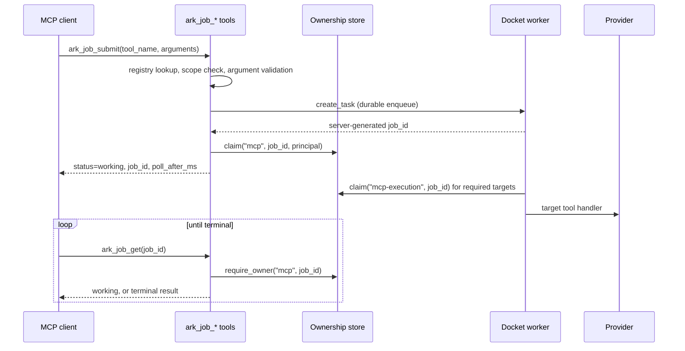

<!-- markdownlint-disable MD013 MD025 -->

# Background Jobs Contract

## Scope

**Long-running Ark work runs in the FastMCP Docket worker, never in the
foreground request.** Clients reach it through one of two entry points that
share the same queue, worker, ownership store and replay guard:

- **`ark_job_*` ordinary tools (default).** Work on any MCP client over stdio
  or Streamable HTTP, with no task-extension negotiation.
- **Native task augmentation.** For clients that negotiate
  `io.modelcontextprotocol/tasks`; polled through `tasks/get`.

This spec covers the `ark_job_*` contract, the registry that decides which
tools may run in the background, and the security invariants both paths keep.
Client workflows live in
[integration-guide.md](../docs/integration-guide.md#background-execution).

| Concern | Code |
|---|---|
| Tool handlers | `src/ark_mcp/tools/background_jobs.py` |
| Registry and FastMCP adapter | `src/ark_mcp/background_jobs.py` |
| Public models | `src/ark_mcp/domain/background_jobs.py` |
| Ownership and replay guard | `src/ark_mcp/security/tasks.py` |
| Registration | `src/ark_mcp/tools/_catalog.py` (static catalog), `src/ark_mcp/server.py` (`register_tools`, `_task_config`, `_task_handler`) |

## Lifecycle

## Tool contracts

### `ark_job_capabilities`

**Lists the targets the caller may submit.** Input: none.

Output `BackgroundJobCapabilities { targets: list[BackgroundJobTarget] }`:

| Field | Type | Meaning |
|---|---|---|
| `tool_name` | `str` | Registered target tool name |
| `task_mode` | `"required"` \| `"optional"` | Native task mode of the target |
| `required_scope` | `str` | OAuth scope needed to submit it in JWT mode |
| `description` | `str` | Target tool description |
| `input_schema` | `dict` | JSON Schema of the target's arguments |

- **Only targets registered on this server instance** are returned; a tool
  whose provider credentials are absent is not registered, so it is silently
  omitted. No credential state is exposed.
- **JWT mode filters by scope**; local mode returns every registered target.

### `ark_job_submit`

**Validates and durably enqueues one target, then returns at once.**

Input `BackgroundJobSubmitInput`:

| Field | Type | Constraint |
|---|---|---|
| `tool_name` | `str` | 1–128 chars; must be a registry key |
| `arguments` | `dict[str, JsonValue]` | The target's complete arguments object, usually `{"input": {...}}` |

Output `BackgroundJobAccepted`:

| Field | Type | Meaning |
|---|---|---|
| `job_id` | `str` | Server-generated ID, 20–128 chars of `[A-Za-z0-9_-]` |
| `target_tool` | `str` | Target tool name |
| `status` | `"working"` | Always `working` at acceptance |
| `created_at` | timezone-aware datetime | Job creation time |
| `ttl_ms` | `int \| null` | Result retention, from the Docket execution TTL; `null` when unlimited |
| `poll_after_ms` | `int` | Suggested delay before the first poll (task poll interval, 2 s for Ark targets) |

Order of checks, each failing as a `ToolError` **before any queue write or
provider call** unless noted:

1. Unknown `tool_name` → "not supported".
2. JWT caller without the target's `required_scope` → "not authorized".
3. Target not registered in this configuration → "not available".
4. Registered task mode differs from the registry → "invalid execution policy".
5. Argument names not accepted by the target signature, or FastMCP coercion
   and validation failure → error; no job is created.
6. After enqueue, the job ID is claimed for the caller. **If the claim fails,
   the new job is cancelled** and the call fails closed.

The server never accepts a client-chosen job ID and **never retries a
submission internally**. A timeout or disconnect is ambiguous: the job may
exist, so callers must not resubmit automatically.

### `ark_job_get`

**Returns current state and, when terminal, the original tool result.**

Input `BackgroundJobIdInput { job_id }` with the same pattern as above.

Output `BackgroundJobSnapshot`:

| Field | Type | Meaning |
|---|---|---|
| `job_id` | `str` | Job ID |
| `status` | `working` \| `input_required` \| `completed` \| `failed` \| `cancelled` | Current state |
| `created_at`, `updated_at` | datetime | Creation and last observed update |
| `ttl_ms` | `int \| null` | Result retention |
| `poll_after_ms` | `int` | Suggested delay before the next poll |
| `result` | `BackgroundJobToolResult \| null` | `content`, `structured_content`, `is_error`, `meta` of the target's `CallToolResult` |
| `error` | `BackgroundJobError \| null` | `code`, `message`, `data` from the task backend |

- **Ownership is checked before the backend is queried.**
- **`input_required` is unsupported** on this path: the snapshot carries error
  code `-32602` telling the caller to cancel or use a task-capable client.
- **Job IDs and provider task IDs are distinct.** A Seedance, Seed 3D, VOD or
  OmniHuman provider `task_id` appears only inside `result.structured_content`.

### `ark_job_cancel`

Input `BackgroundJobIdInput`. Output `BackgroundJobCancelled { job_id,
status: "cancelled" }`.

**Cancellation stops the local worker cooperatively.** It does not claim that
a provider operation already accepted by BytePlus was cancelled.

### Errors shared by get and cancel

Unknown, expired, malformed and cross-owner job IDs all return the **same
outward error**, so the response is not an existence oracle:

- JWT mode: "Background job is not available to this principal."
- Local mode: a message explaining that local jobs are process-local and must
  be polled through the same server process (or one shared HTTP server).

### Tool annotations

| Tool | readOnly | destructive | idempotent | openWorld |
|---|---|---|---|---|
| `ark_job_capabilities` | true | false | true | false |
| `ark_job_submit` | false | false | false | true |
| `ark_job_get` | true | false | true | false |
| `ark_job_cancel` | false | true | false | true |

All four are foreground tools with no `TaskConfig`. In JWT mode they require an
authenticated token but no scope of their own; the target's scope is enforced
inside `ark_job_submit` and `ark_job_capabilities`.

## Background-tool registry

**The static tool catalog (`src/ark_mcp/tools/_catalog.py`) is the single
source of truth** for which tools exist, their scopes, and which run in the
background. `BACKGROUND_TOOL_SPECS` in `src/ark_mcp/background_jobs.py` is
derived from it at import time: an immutable `MappingProxyType` of tool name →
`BackgroundToolSpec(mode, required_scope)` for every entry with a background
mode. A background entry without a scope fails at import. Every consumer
reads it:

- `_task_config(name)` builds the native `TaskConfig` (poll interval 2 s).
- `register_tools` takes the JWT scope from the catalog entry.
- `_task_handler` wraps **required** targets with `guard_task_execution` and
  instruments every registered target.
- `ark_job_capabilities` and `ark_job_submit` resolve targets from it.
- `record_background_job_submission` ignores names outside it, which bounds
  metric cardinality.

| Mode | Foreground call | Used for |
|---|---|---|
| `required` | **Rejected before the handler runs** | Generation, editing, understanding, transcription, upload, and provider task creation |
| `optional` | Runs synchronously | Provider status reads and persistence that may download large outputs (`*_get_task`, `seed_media_persist_url`, selected asset-library calls) |

A tool absent from the registry cannot be submitted through `ark_job_submit`,
including the `ark_job_*` tools themselves.

## Security invariants

1. **Allowlist only.** `tool_name` must be a registry key and registered on
   the running server.
2. **Target-scope authorization.** In JWT mode the caller must hold the
   target's exact scope before validation or enqueue.
3. **Application ownership.** Job IDs are claimed in the `TaskOwnershipStore`
   under the `mcp` namespace, keyed by principal and tenant. `ark_job_get`,
   `ark_job_cancel` and every native `tasks/*` method call
   `require_mcp_task_owner` first (`TenantTasksExtension._owned_handler`).
   Native task creation claims ownership in
   `TenantTasksExtension.intercept_tool_call`. FastMCP's own client/subject
   task scope is defense in depth, not the tenant boundary.
4. **Replay guard.** `guard_task_execution` claims each required execution in
   the `mcp-execution` namespace before the handler runs. A redelivered
   execution finds the claim and **fails instead of repeating billable
   provider work**. Claims are never released. Optional targets stay
   repeatable and rely on the persistence single-flight cache.
5. **Snapshot protection.** JWT mode with a Redis Docket backend refuses to
   start without `FASTMCP_TASKS_ENCRYPTION_KEY`.
6. **Safe logging.** Job events (`background_job_accepted`,
   `background_job_polled`, `background_job_cancelled`) carry only job ID,
   target, status and path, never arguments or result bodies.
7. **No existence oracle.** See [shared errors](#errors-shared-by-get-and-cancel).
8. **No automatic paid retry.** Neither the server nor the documented client
   workflow resubmits after a timeout or disconnect.

## Observability

`ark_mcp_background_job_submissions_total{target, status, path}` counts
admissions: `status` is `accepted` or `rejected`, `path` is `compatibility`
(`ark_job_submit`) or `native`. See
[observability.md](../docs/observability.md).

## Known constraints

- **FastMCP internals.** The adapter imports `fastmcp_tasks.creation.create_task`
  and `fastmcp_tasks.handlers.tasks_get` / `tasks_cancel`, which are not public
  API. The dependency is pinned to `fastmcp[tasks]>=4.0.3,<4.1`; only
  `BackgroundJobBridge` may import them.
- **No listing or input API.** There is no `ark_job_list` and no
  `ark_job_update`; callers keep the job ID returned at submission.
- **Single replica.** Ownership and execution claims live in the SQLite
  runtime database; see [deployment.md](../docs/deployment.md#background-tasks-in-a-single-replica-deployment).

## Sources

- [FastMCP background tasks](https://gofastmcp.com/servers/tasks), accessed
  2026-09-13.
- [MCP tasks specification](https://modelcontextprotocol.io/specification/2025-11-25/basic/utilities/tasks),
  accessed 2026-09-13.
