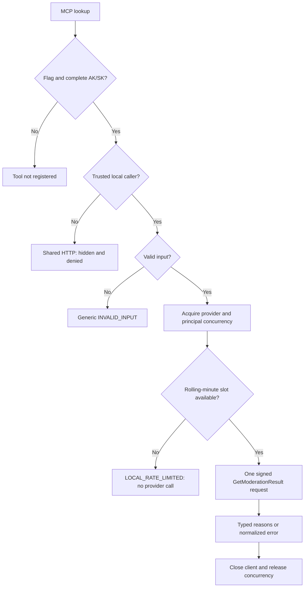

# ModelArk Moderation Lookup

This finalizes the recovered `PLAN_MODELARK_MODERATION_RESULT.md` against the
current local/shared-key authentication architecture. The restricted provider
reference was reviewed on 2026-11-16, revision 247; original text, screenshots,
private links, and real response fixtures are excluded. Publication of this
minimal integration contract was explicitly approved by the operator.
User guidance: [moderation.md](../docs/moderation.md).

## Contract

`ark_moderation_get(input: ModerationGetInput, ctx: Context)` is foreground-only,
read-only, idempotent, non-destructive, and open-world. It is excluded from
ordinary jobs and native task augmentation.

Input requires `id` and `type`. IDs are strict strings, trimmed, 1-256 characters,
without internal whitespace, controls, or URI schemes. Types are `task_id`,
`asset_id`, and `request_id`; extra fields are forbidden. IDs are opaque:
no inference of model, age, eligibility, or ownership from their prefixes.

Success echoes `id`, `type`, and required `block_reasons`. Each reason requires a
nonempty strict string `label` and strict string `sub_label`; `detail` is optional
and nullable. Unknown categories and extra provider fields are tolerated.
Malformed known fields fail with generic `INVALID_RESPONSE`, without raw body or
validation inputs. Empty reasons are preserved, never interpreted as approval.
Errors are text-only MCP tool results, not success-shaped data.

## Access And Flow

Registration requires complete OpenAPI AK/SK and the default-off
`BYTEPLUS_MODELARK_MODERATION_ENABLED` flag. Existing partial-key and orphan-STS
validation remains unchanged. Discovery and health describe local configuration,
not provider entitlement.

Trusted local stdio and local-mode loopback HTTP can query account-wide records,
without task ownership restrictions. The `moderation:read` catalog label is not
granted to production shared-key HTTP callers. No JWT operator configuration or
tenant-facing moderation privilege is introduced.

`ModerationInputPrivacyMiddleware` resolves principal and authorized tool before
validating the exact input envelope. Authorized invalid calls return a generic
error before framework validation can log private values. Unauthorized calls
keep the original authorization path; other tools are unaffected.

`ModerationService` calls `ModelArkOpenApiGateway` once with action
`GetModerationResult`, service `ark`, version `2024-01-01`, configured host/region,
and exactly `{"Id": id, "Type": type}`. No project, model, media, or Bearer field
is added. Temporary credentials include signed `X-Security-Token`.

A runtime-owned monotonic deque guarded by an async lock admits ten requests per
rolling minute. Reserve only after acquiring concurrency; quota exhaustion fails
promptly without waiting. Dispatched failures and cancelled reservations consume
quota; cancelled concurrency waiters do not. All paths release concurrency and
close any per-call HTTP client. The guard is in-memory, not a distributed quota.

There are no automatic retries or result persistence. Valid finite nonnegative
numeric or timezone-aware HTTP-date `Retry-After` values provide explicit retry
guidance; malformed values are ignored. Existing mutation retry classifications
remain unchanged.

## Evidence

Provider requirements: Advanced Creation Rights, whitelist activation, IAM
`GetModerationResult`, fourteen-day records created after whitelist activation.
Documented image/video/audio coverage includes supported Seedance 2.0 variants,
regular 2.5, and material assets. Text and 2.5 request-ID queries are excluded;
Flash, Seedream, and 3D support is not claimed. Lookup pricing is unspecified.

Offline validation is covered by `tests/unit/test_moderation.py`,
`tests/contract/test_modelark_moderation.py`,
`tests/integration/test_moderation_tools.py`, and catalog/schema regressions.
The isolated smoke runner is `scripts/smoke_moderation.py`.

Live success remains unverified. An authorized account with whitelist access and
an eligible already-blocked record is required. Authentication success, a 403,
a 404, or empty reasons is not evidence of a successful moderation lookup.
