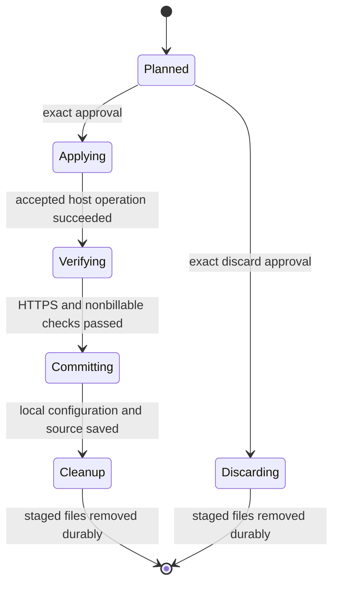

# Provider Secret Manager Sync Contract

## Scope

The checkout deployment CLI supports operator-driven BytePlus generic-secret
reads and provider-only configuration sync. This is implemented and
offline-tested, not account-enabled or live-certified. It does not add MCP
tools, automatic rotation, VM IAM credentials, startup fetch, adoption,
Terraform-managed secrets or a web UI.

## Secret Source

A protected reference has exactly five string fields: `region`, `account_id`,
`project_name`, `secret_name`, `version_id`. Johor
`kms.ap-southeast-1.byteplusapi.com` is the only allowlisted endpoint. Secret
names use the conservative documented 2-31-character ASCII limit; versions
must be canonical lowercase UUIDs. This selection is independent of the VM
region and uses operator AK/SK plus the matching STS token when applicable.

Signed GET requests use service `kms`, version `2021-02-18`, and no redirects
or automatic retries. `DescribeSecret` must match name, string account UID,
project, type `Generic`, and `Managed=false` before `GetSecretValue` sends the
explicit `VersionID`. The returned version must match.

`SecretValue` is a bounded JSON object with only:
`BYTEPLUS_MODELARK_API_KEY`, `BYTEPLUS_SEED_SPEECH_API_KEY`,
`BYTEPLUS_VOD_MEDIAKIT_API_KEY`, `BYTEPLUS_CV_API_KEY`.
Missing/empty entries intentionally disable products. At least one is
nonempty. Duplicate fields, other fields, non-string values, non-ASCII,
whitespace, interpolation/quoting characters and oversized values fail
without echoing content.

## Approval and Recovery

`config status` reports only local key presence and source metadata.
`config plan` requires a ready, provenance-checked CLI deployment with no
pending update/verification/config transaction. It freezes one source version
and stages old/new complete configuration files mode 0600. Approval binds
frozen source, exact instance, secret reference, sequence and old/new full
configuration digests. Output contains changed field names, not values or
per-field hashes. `config discard` applies only before submission and requires
the exact approval.

`config apply` checks approval and exact cloud resource identities, then uses
instance-bound encrypted transfer. The host validates the existing receipt,
protected files, both environments and equality of every non-provider field.
Only MCP is recreated with bounded forward/rollback grace; Redis, Caddy,
SQLite, artifacts and runtime authentication/encryption secrets stay intact.
Operators must pause producers and drain paid work before approval.

Guest accepted invocation IDs are journaled and unknown acceptance blocks
replay. Resume never rereads KMS; it uses staged bytes. Transport attempts and
durable host transaction identities are distinct. Before retrying a failed
transport, a root-private host receipt is inspected: pending/applied host work
retains its identity; a reconciled rollback receives a fresh host transaction.
Only status and complete configuration digests participate in reconciliation.

The host keeps a protected prior-config backup and atomic transaction marker
before publication. A pending restart accepts only old/candidate digests and
the matching backup. Applied markers are idempotent; rolled-back markers are
not reapplied. Startup failure restores old configuration/receipt and attempts
MCP-only recovery. Recovery failure retains private evidence. Successful
activation deletes the backup and candidate durably and leaves nonsecret
receipt evidence. Locked reconciliation finishes interrupted applied/rolled-back
cleanup before advancing host identity; recovery-failed backups remain private.
Terminal encrypted receivers delete and fsync managed transfer material.
Before a fresh provider transfer, a journaled cleanup also removes the previous
failed transport's key and envelopes, including abrupt-interruption leftovers.

Local committing/cleanup/discarding phases remain pending until secret-file
deletion and directory fsync complete. Cleanup resume performs no KMS read or
guest replay. Pending configuration blocks competing image updates, new plans
and premature verification. Ordinary resume cannot approve a merely planned
update.

Atomic writers reserve `.deploy-????????` within the operator workspace and
`.provider-????????` within the protected host configuration directory.
Plan/apply/cleanup and locked host reconciliation validate same-owner regular
0600 leftovers, delete them, and fsync the directory. These reserved temporary
names must not be used for operator-owned files. Recoverable transaction backups,
receipts, and the active lock are outside these cleanup patterns.

## Limits

HTTPS, discovery and nonbillable dry-run success do not validate provider
credentials. Completed-sync rollback explicitly selects a prior retained KMS
version and goes through a fresh plan/approval. KMS writes, product-key
revocation, IAM policy creation and scheduling are operator tasks.

Local staging, runtime `.env` and recovery backups remain private plaintext
at rest; encrypted storage and secured backups are required. Source/helper
changes require separately reviewed migration of older frozen/manual
deployments. Never bypass provenance or reapply bootstrap replacements as an
automatic upgrade.
